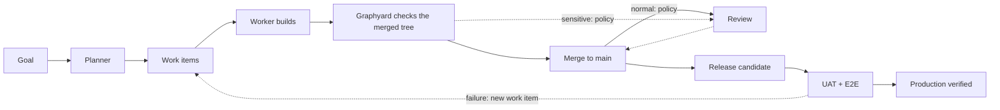

# Graphyard

Graphyard is a control plane that runs a team of AI coding agents on a repository. Its goal is software that ships itself: agents build, verify, review and release, while the human keeps three decisions: goals and priorities, spending money or opening accounts, and issuing credentials to people.

## Start here: setup and docs

One command, then the [setup checklist](docs/setup-from-zero.md):

```sh
graphyard up --agent --goal GOAL.md
```

[Install](docs/install.md), [How Graphyard works](docs/how-graphyard-works.md), [Onboarding](docs/onboarding.md), [Documentation](docs/README.md)

**[docs/install.md](docs/install.md) is the primary install path** (`install --provider railway|hetzner|compose`). Contribute: [AGENTS.md](AGENTS.md), [development](docs/development.md). Licence: [Apache 2.0](LICENSE).

## How it works

1. You give Graphyard a goal in a plain-language file.
2. A planner agent turns the goal into small work items with acceptance criteria.
3. A worker agent takes over: it builds each work item on its own branch.
4. Graphyard checks the merged tree: build, tests and the change's E2E cases against its preview, before the merge to main.
5. An independent agent reviews; the repository's `graphyard.json` sets the timing (`review.normalChanges`), the sensitive paths (`risk.sensitive`), generic defaults otherwise ([delivery](docs/delivery.md)).
6. About every ten merges a release candidate goes to a test environment for UAT + E2E (user acceptance, end-to-end).
7. A passing candidate is promoted to production and checked there: production verified.
8. A failure anywhere is reverted or fixed by a new work item.

Only Graphyard writes to main, merging pull requests that pass every check.



Text equivalent: the steps above.
