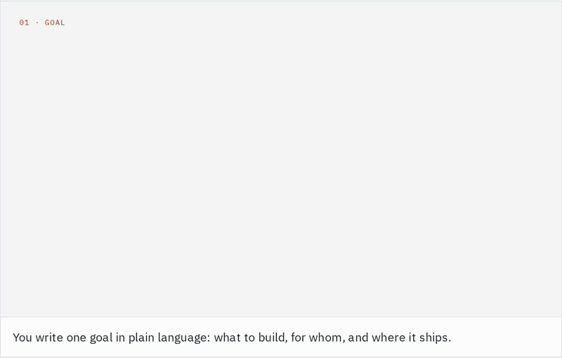
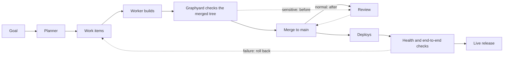

# Graphyard

Graphyard is a control plane that runs a team of AI coding agents on a repository. Its goal is software that ships itself: agents build, verify, review and release, while the human keeps three decisions: goals and priorities, spending money or opening accounts, and issuing credentials to people.

[](docs/diagrams/how-graphyard-works.mp4)

## Start here: setup and docs

[Setup checklist](docs/setup-from-zero.md):

```sh
graphyard up --agent --goal GOAL.md
```

[Install](docs/install.md) · [How Graphyard works](docs/how-graphyard-works.md) · [Onboard a repository](docs/onboarding.md) · [Documentation](docs/README.md)

**[docs/install.md](docs/install.md) is the primary install path** (`install --provider railway|hetzner|compose`). Contribute: [AGENTS.md](AGENTS.md), [development](docs/development.md). Licence: [Apache 2.0](LICENSE).

## How it works

1. You give Graphyard a goal in a plain-language file.
2. A planner agent turns the goal into small work items with acceptance criteria.
3. A worker agent takes over: the worker builds each work item on its own branch.
4. Graphyard checks the merged tree: build, tests and the change's E2E cases against its preview, before merging to main.
5. An independent agent reviews, before the merge for sensitive changes and after the merge for everything else, by default.
6. Graphyard merges to main, and every merge deploys on its own: health and end-to-end checks run on the live release.
7. A failed check rolls the release back; the change returns to a worker with the failure attached.
8. Only Graphyard writes to main.

graphyard.json sets sensitive paths (`risk.sensitive`) and normal-change review timing (`review.normalChanges`): [delivery](docs/delivery.md).



Text equivalent: steps 1-8.
