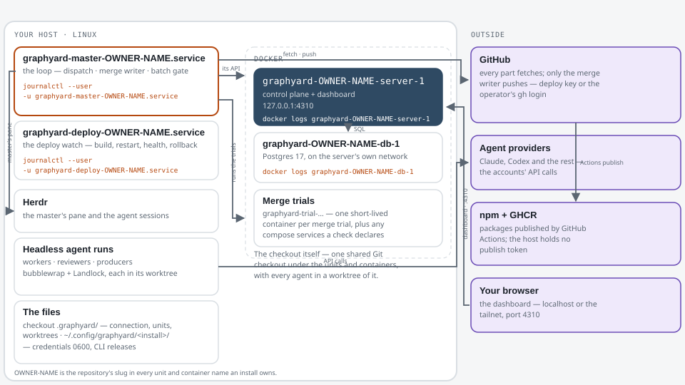

# Graphyard

**Run AI coding agents like Claude Code and Codex, ship each goal to production with independent review and proof.**

[](docs/diagrams/how-graphyard-works.mp4)

## Why Graphyard

- **You decide goals, money, credentials.** An AI master plans the rest.
- **Every change is proven.** Workers build, agents review, heads are trialled on main.
- **Production stays safe.** Main deploys itself; failures revert automatically.

Prerequisites (Linux host): Linux 7.0+ with Landlock ABI 9+ (`uname -r`); Node/npm (`node --version`, `npm --version`); Git durable SSH checkout (`git --version`, `git remote -v`); Docker and Compose (merge trials need them even `--local`) (`docker version`, `docker compose version`); GitHub CLI admin login (`gh auth status`); bubblewrap (`bwrap --version`); Python (`python3 --version`); Herdr (`herdr --version`); systemd (`systemctl --user status`). `graphyard guide setup` explains.

## Quick start

```sh
npx @cryptob1/graphyard up --repo OWNER/NAME
```

The Setup link connects worker and reviewer accounts, file goals under **New work item**: title and optional description; the master writes the criteria; **Advanced** takes full detail. Workers and reviewers run headless, logged per item (`graphyard guide runtimes`). Where a SAML organization or org policy blocks deploy keys, `--push-auth gh` pushes with your gh login instead of a deploy key. Watch: `graphyard master status`; update: `graphyard upgrade --plan` then `graphyard upgrade`; `graphyard doctor` verifies. Setup invites or revokes viewers and maintainers.

## Where things run



`graphyard guide infra` lists every part with its log command; the Setup page shows this install's own names.

## Learn more

- `graphyard guide TOPIC` and `graphyard master guide` print every procedure.
- Verified deploys publish `@cryptob1/graphyard` with npm OIDC provenance plus both GHCR images via Actions — no host publish token. `graphyard guide publishing` covers owner setup.
- [Re-render the walkthrough](docs/walkthrough.md) · [Contributing](AGENTS.md) · [Apache 2.0](LICENSE)
