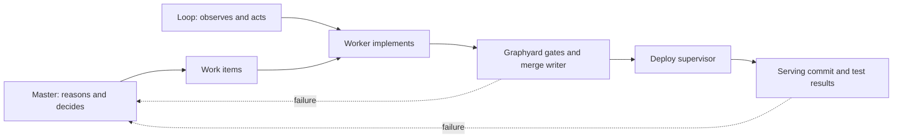

# Graphyard

Graphyard coordinates AI coding agents on a repository. The **master** is an AI coordinator: it reads failures, reasons about what to do, and decides the next action. The **loop** is a repeating program: it observes state, starts sessions, and carries out routine actions. **Workers** implement each item in its assigned worktree. Graphyard owns leases, history and gates; Herdr runs sessions and reports their state.

The human keeps exactly three decisions: goals and priorities, spending money or opening accounts, and issuing credentials to people. The master applies every other decision under its operator-agent identity. Review, proof and routine repairs proceed automatically.

[](docs/diagrams/how-graphyard-works.mp4)

## Start here: setup and docs

```sh
graphyard up --agent
```

Follow the [setup checklist](docs/setup-from-zero.md) or [install guide](docs/install.md) (`install --provider compose|local`). Read [How Graphyard works](docs/how-graphyard-works.md), [onboarding](docs/onboarding.md), or the [documentation index](docs/README.md). Contributors: [AGENTS.md](AGENTS.md), [development](docs/development.md). Licence: [Apache 2.0](LICENSE).

## How it works

1. The master files work with acceptance criteria. The loop releases eligible backlog and starts workers.
2. A worker implements, checks and submits an exact commit under its lease. Submission ends the lease.
3. Graphyard runs proofs in the merge trial and requests independent review. Sensitive changes wait for approval before merge; other changes receive review after merge.
4. The merge writer tests the change merged onto main, then alone pushes main with the install's deploy key.
5. The deploy supervisor (`graphyard-deploy.service`, with an install-specific name on new installs) builds and serves new main commits. Deployment health and required end-to-end checks report what is live.
6. Failures trigger the appropriate retry, rework or recovery. The master handles causes that need judgment, without asking for routine human approval.

For example, if a trial check fails on both the change and main, the merge writer holds it as a base failure. The loop prompts the master with the failure. The master diagnoses the test and files or advances a repair; a worker fixes it, and the writer retries with the gates intact. Running loop cycles alone do not prove delivery progress: check the item history, merged commit, served commit and required test results. See [master wakes and delivery progress](docs/master-agent.md#master-wake-and-delivery-progress) for changed-cause prompts and the fallback heartbeat.



Text equivalent: the six steps above. [Delivery](docs/delivery.md) describes trials, deploys and recovery; `graphyard.json` sets sensitive paths in `risk.sensitive`.
