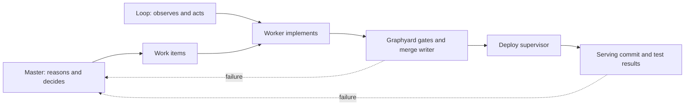

# Graphyard

Graphyard coordinates AI coding agents on a repository. The **master** decides what to do; the **loop** observes state and starts sessions. **Workers** implement items in assigned worktrees. Graphyard owns leases, history and gates; Herdr runs sessions and reports their state.

The human keeps exactly three decisions: goals and priorities, spending money or opening accounts, and issuing credentials to people. The master handles other decisions, review, proof and repairs automatically.

[](docs/diagrams/how-graphyard-works.mp4)

## Start here: setup and docs

1. Prepare Node 24+, Git, GitHub CLI and a clean Graphyard CLI checkout with dependencies installed and `bin/` on your PATH. Use Linux with systemd user services and bubblewrap. Install Docker Engine and Compose; alternatively, the local provider runs the control plane on embedded Postgres (merge trials still use Docker). Herdr runs agent sessions; setup installs it if missing. Run `gh auth login --scopes repo` as an administrator of your repository.
2. In the repository checkout, replace `OWNER/NAME` and run:

   ```sh
   graphyard up --repo OWNER/NAME --provider compose --master claude
   ```

   Choose `--provider local` for embedded Postgres, or `--master codex` for Codex. Setup installs services, registers the merge writer's deploy key, and configures agents. Rerun the same command to resume.
3. Open the printed Setup link. Connect AI coding accounts for worker and reviewer roles (the same account can serve both), using API keys or subscription sign-ins; approve browser logins. Existing host logins are discovered automatically. Wait for the checklist to turn green and onboarding changes to merge.
4. After “Everything is green”, run `graphyard master status` to inspect sessions and work. Open the final sign-in link within ten minutes.
5. File your first goal in the dashboard's **New work item** form: give it a title, description, checkable acceptance criteria and required proof names. The master handles planning and dispatch.
6. Later, preview updates with `graphyard upgrade --plan`, then apply with `graphyard upgrade` on the configured host.

Details: [setup checklist](docs/setup-from-zero.md), [install guide](docs/install.md), [onboarding](docs/onboarding.md), [documentation index](docs/README.md). Contributors: [AGENTS.md](AGENTS.md), [development](docs/development.md). Licence: [Apache 2.0](LICENSE).

## How it works

Workers submit commits under leases. Graphyard requests proofs and review; sensitive changes need pre-merge approval. The merge writer tests and pushes main, and the deploy supervisor serves it. The master handles failures.



[Delivery](docs/delivery.md) describes trials, deploys and recovery; `graphyard.json` sets sensitive paths in `risk.sensitive`.
