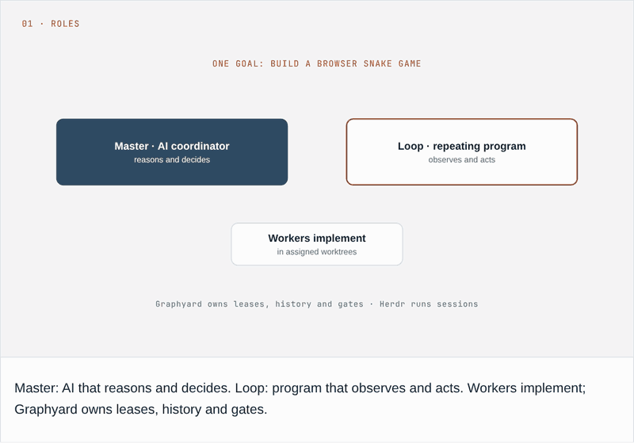
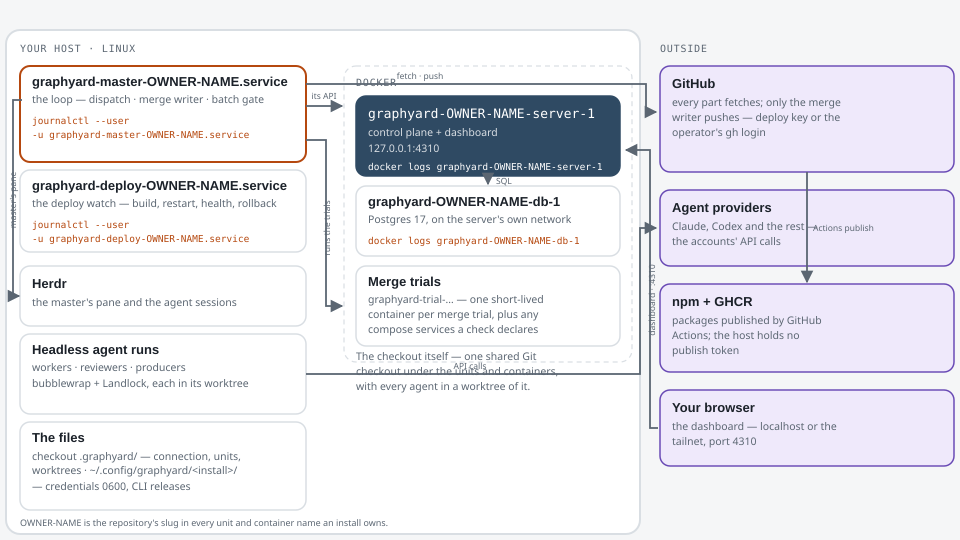

# Graphyard

**Run AI coding agents like Claude Code and Codex, ship each goal to production with independent review and proof.**

[](docs/diagrams/how-graphyard-works.mp4)

## Why Graphyard

- **You decide goals, money, credentials.** Tell any agent; reverse relayed answers under Needs you. Master handles blockers.
- **Every change is proven.** Workers build, agents review, main trials each head.
- **Production stays safe.** Main deploys itself; failures revert.

Prerequisites: Linux 7.0+ with Landlock ABI 9+ (`uname -r`); Node 24+/npm (`node --version`, `npm --version`; Ubuntu/Debian: `curl -fsSL https://deb.nodesource.com/setup_24.x | sudo bash - && sudo apt install nodejs`, Arch: `sudo pacman -S nodejs npm`, macOS: `brew install node@24`); Git; Docker with Compose; GitHub CLI; bubblewrap; Python; Herdr (`herdr --version`; install: `curl -fsSL https://herdr.dev/install.sh | sh`); systemd. [Setup guide](docs/setup.md).

## Quick start

```sh
git clone https://github.com/cryptob1/graphyard.git && cd graphyard
npm ci
npm run build
node bin/graphyard.mjs up --repo OWNER/NAME
```

Once published to npm:

```sh
npx @cryptob1/graphyard up --repo OWNER/NAME
```

The Setup link connects worker and reviewer accounts, file goals under **New work item**: title and optional description; the master writes the criteria; **Advanced** takes full detail. `graphyard master status`; `graphyard upgrade --plan` then `graphyard upgrade`; `graphyard doctor` verifies. A project is onboarded once it serves the real app and has a feature map. Sharing: **Invite** gives one link that signs a person in once, from any device.

## Where things run



`graphyard guide infra` lists every part.

## Learn more

- `graphyard guide setup`, `graphyard guide publishing`, `graphyard guide TOPIC` and `graphyard master guide` print procedures.
- [Shared server](docs/shared-server.md), [Re-render the walkthrough](docs/walkthrough.md), [Contributing](AGENTS.md), [Apache 2.0](LICENSE)
