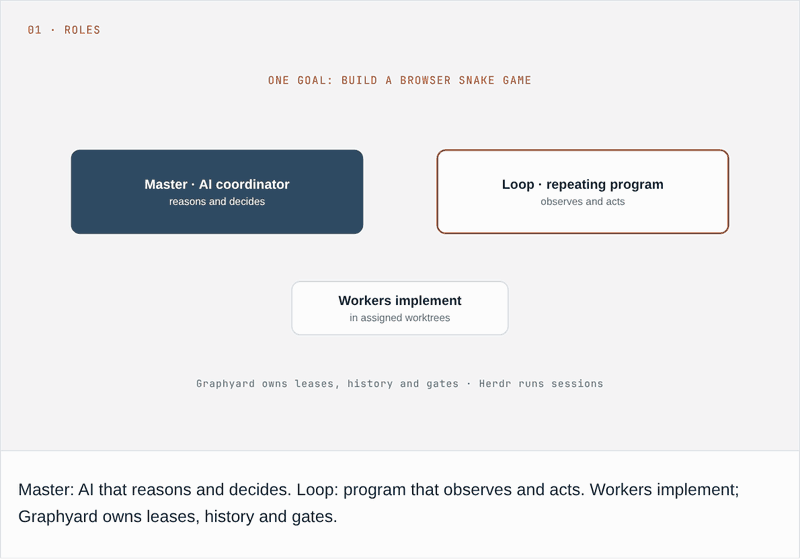

# Graphyard

**Run AI coding agents like Claude Code and Codex on your repository, and ship each goal from one sentence to production with independent review and proof.**

[](docs/diagrams/how-graphyard-works.mp4)

The four roles are worker, reviewer, producer and master.

## Why Graphyard

- **You decide only goals, money and credentials.** An AI master plans everything else.
- **Every change is proven.** Workers build, a separate agent reviews, and the merge writer trials each head on the latest main.
- **Production stays safe.** Main deploys itself; a failing release is reverted automatically.

## Prerequisites

In your repository's checkout on a Linux host, check these prerequisites first:

| Prerequisite | Check command |
| --- | --- |
| Linux 7.0+ with Landlock ABI 9+ enabled | `uname -r` (doctor checks the ABI) |
| Node.js 24+ and npm | `node --version && npm --version` |
| Git; checkout on durable storage, with an SSH origin for the merge writer | `git --version && git rev-parse --show-toplevel && git remote -v` |
| Docker Engine running and accessible to your user (also needed for merge trials with `--local`) | `docker version` |
| Docker Compose plugin (default install) | `docker compose version` |
| GitHub CLI signed in with repo scope and repository administration access | `gh auth status && gh repo view OWNER/NAME --json viewerPermission` |
| Bubblewrap for worker confinement | `bwrap --version` |
| Python 3 for the Landlock probe | `python3 --version` |
| Herdr for agent sessions (`up` installs it automatically if absent) | `herdr --version` |
| systemd user manager for persistent services | `systemctl --user status` |

Install bubblewrap with `sudo apt install bubblewrap` (Debian/Ubuntu) or `sudo pacman -S bubblewrap` (Arch). Sign in to GitHub with `gh auth login --scopes repo`. Organization policy must allow deploy keys; otherwise use `--merge-token-stdin` with a repository-scoped fine-grained token granting Contents read/write. No GitHub App is needed.

`up` also checks the repository's `graphyard.json` policy and generated-file manifest (if declared), available loopback ports, and embedded Postgres dependencies for `--local`. Preview these checks with `npx @cryptob1/graphyard install --repo OWNER/NAME --plan` (`--provider local` for local mode).

## Quick start

From your repository's checkout:

```sh
npx @cryptob1/graphyard up --repo OWNER/NAME
```

It installs Graphyard and prints a Setup link: open it and connect accounts for the worker and reviewer roles (`--master codex` runs a Codex master; `--local` skips Docker for the control plane). Then file a goal in **New work item** with acceptance criteria and required proof names, and watch it with `npx @cryptob1/graphyard master status`. Graphyard updates itself daily; `npx @cryptob1/graphyard upgrade --plan`, then `npx @cryptob1/graphyard upgrade`, updates it now. Installs share your main Herdr. In Setup, the operator can invite viewers or maintainers with a one-time sign-in link and revoke invitations made from that page.

Run `npx @cryptob1/graphyard doctor` from the connected checkout to check credentials, agent logins, worker confinement, the kernel and running services; failed checks print the fix.

## Learn more

- `graphyard guide TOPIC` and `graphyard master guide` print the procedures agents follow; `graphyard --help` lists every command.
- [Re-render the walkthrough](docs/walkthrough.md) · [Contributing](AGENTS.md) · [Apache 2.0](LICENSE)

## Publishing

After a verified commit deploys successfully, Graphyard pushes its `vYYYY.M.D-<sha12>` tag with the merge writer's deploy key. GitHub Actions publishes `@cryptob1/graphyard` with npm OIDC provenance and both GHCR images (`graphyard` and `graphyard-trial`, tagged by commit and `verified`) with `GITHUB_TOKEN`. The host holds no registry publish token. Publication runs separately from merge and deployment; `graphyard master status` shows npm's latest version alongside Graphyard's serving commit.

One-time owner setup:

1. From your own npm login, publish a minimal `@cryptob1/graphyard` placeholder at version `0.0.0` with `npm publish --access public` (the package must exist first).
2. In the npm package's settings, add a **Trusted Publisher**: GitHub Actions, owner **cryptob1**, repository **graphyard**, workflow **publish.yml**.
3. In each GHCR package's settings (**graphyard** and **graphyard-trial**), grant the **cryptob1/graphyard** repository Actions write access.

Actions and the offline installation proof both run `node scripts/build-publisher.mjs` to build `scripts/publish-verified.mjs` from TypeScript. The script reads `GRAPHYARD_PUBLISH_COMMIT`, `GRAPHYARD_IMAGE_REGISTRY`, `npm_config_registry` and `GITHUB_TOKEN` from its environment; Actions passes `--provenance` and uses Node 24, npm 11.5.2 and a fresh buildx builder. Local registry tests alone supply `NPM_TOKEN` through their environment. The post-deploy live check waits for owner setup, then checks the next release's npm version, embedded commit, workflow-linked provenance and both commit-tagged images.
