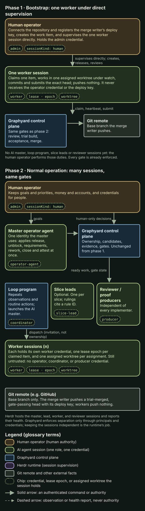
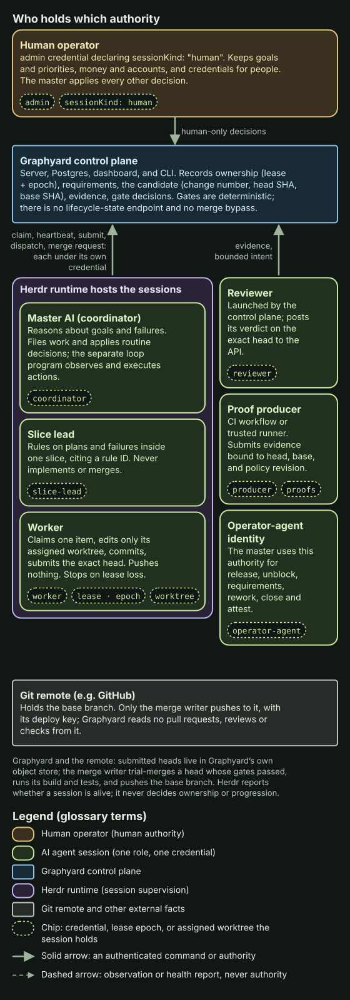
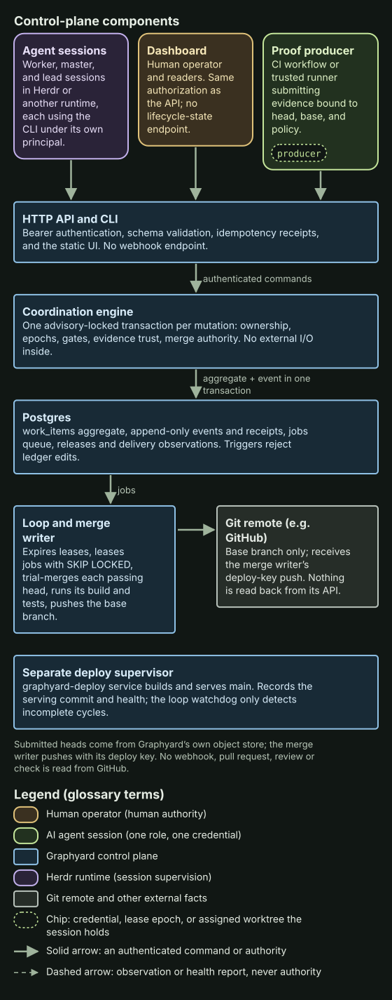

<!-- page: Start here | 1 | roles and delivery -->
# How Graphyard works

## Start with the roles

The **master** is an AI coordinator: it reasons and decides. The **loop** is a repeating program (`master run`): it observes state and executes routine actions. **Workers** implement; independent reviewers judge changes.

Graphyard owns leases, append-only history and gates independently of Herdr. Herdr starts sessions and reports liveness; a running session cannot grant itself ownership or advance a gate. The master acts under its operator-agent identity for every decision except the human's three: goals and priorities, money and accounts, and credentials for people. No new human approval is needed for routine action.

## One trip to Done

1. **Ready:** released, unblocked work names proofs; features receive a spec check.
2. **Build:** a worker claims a lease/worktree and submits its exact commit, ending the lease. Workers push nothing.
3. **Review:** sensitive changes wait for independent approval; user-facing features also get product review.
4. **Test and acceptance:** the writer tests the merged tree and counts proof cases; sensitive changes need required manual attestations.
5. **Done:** passing gates allow the writer to push main. Done means merged.
6. **Delivery:** the separate deploy supervisor serves main; required checks establish live verification.

A cycle can complete while every item remains stuck. Check item history, merge ledger, served commit and required case results to measure progress.

## The spec check before dispatch

A fresh-context reviewer restates each feature's result, proofs and gaps before dispatch. First `gaps` holds for `master requirements`; one re-check follows, then dispatch includes its report even if gaps remain. Bugs and chores skip it. Prompts come from Google's [Elephant-Goldfish Model](https://github.com/google/elephant-goldfish-model), vendored under `vendor/egm/`.

## From intent to work items

The master files with `master create`; the loop releases eligible backlog by priority and capacity. `master release` pulls out of order. Keep held work blocked; items dispatch whole.

For example, a check fails on both main and a change. The writer holds it as a base failure. The loop prompts the master with the failed check and next repair action. The master diagnoses it and advances repair work; a worker fixes it, then trials resume with gates intact. See [master wakes and delivery progress](master-agent.md#master-wake-and-delivery-progress).

## The one review rule

A delta touching `graphyard.json` `risk.sensitive` needs one independent approval before merge; an unknown delta counts as sensitive. Other changes merge on a passing trial and receive review afterward. A blocking post-merge finding becomes a follow-up item.

Product review walks a user-facing feature's preview (or served app plus diff). Approval advances, changes rework, rejection goes to master for closure. Bugs, chores and `No user-facing change:` descriptions skip it. New heads get review unless only non-UI files changed. Findings/screenshots stay on the item.

## Who holds which authority

Bootstrap: one supervised worker. Normal operation: master, loop and independent sessions.

Each session has its own identity ([legend](glossary.md#diagram-legend)).

## Correctness rules

Mutations and history commit in locked transactions without external I/O. Gates bind change number, head/base SHA and policy revision. Later trusted results supersede earlier ones. Only the writer pushes main; no arbitrary lifecycle-state endpoint exists. See [delivery](delivery.md).
