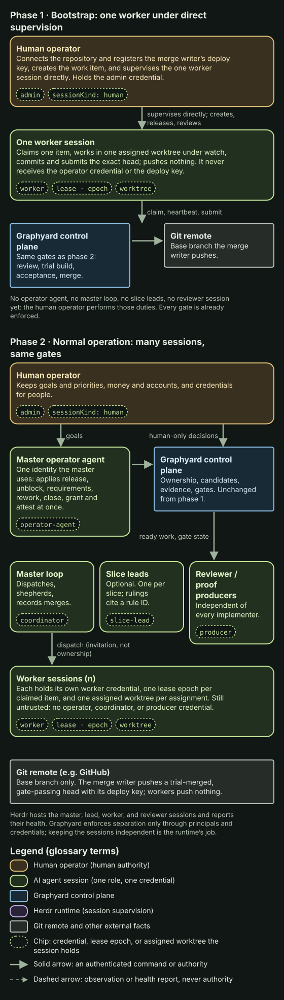
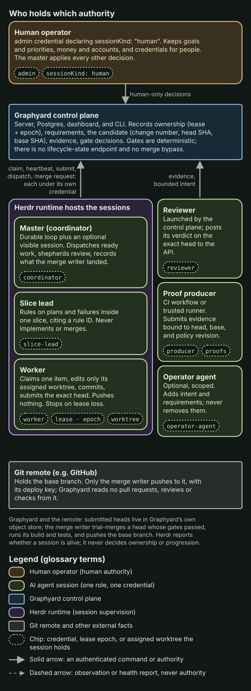
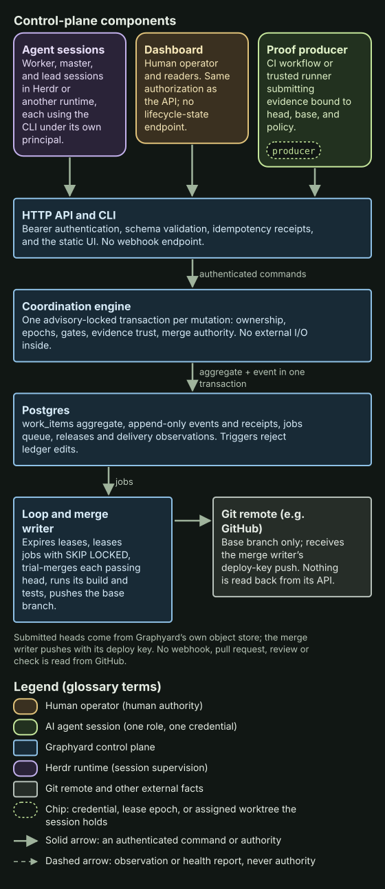

<!-- page: Start here | 1 | lifecycle -->
# How Graphyard works

Graphyard decides whether work advances; runtimes (Herdr) run sessions.

## One trip to Done

1. **Ready**: released, unblocked, criteria name proofs.
2. **Build**: worker claims lease and worktree, submits the exact commit, pushes nothing.
3. **Review**: a [sensitive](#the-one-review-rule) commit waits for one independent approval; a user-facing feature also waits for its product review.
4. **Test**: the merge writer trial-merges onto base, runs build and tests.
5. **Acceptance**: roster producers report the criteria's proofs.
6. **Done**: Graphyard rechecks gates, pushes base, observes.

## From intent to work items

The master files items (`master create`) and releases backlog itself (`master release`); an item of any size is dispatched whole. Review follow-ups are ordinary backlog items.

## The one review rule

A head whose merge delta touches a `graphyard.json` `risk.sensitive` path (generic default; unknown delta: sensitive) waits for one independent approval before the merge writer merges it. Any other head merges on its passing trial and is reviewed after the merge; a blocking finding becomes a follow-up item.

A user-facing feature (a `feature` carrying an `e2e:` proof, not opted out) also waits for its product review: a reviewer session walks the head's preview and the served app, then approves, requests changes (rework, with the findings), or rejects — a reject is closed by the master, never merged. Bugs, chores and "No user-facing change" items skip it; a new head is reviewed afresh unless only non-UI files changed. Its verdict, findings and screenshots show on the item.

## Who holds which authority

Text equivalent: in bootstrap the human operator supervises one worker; later master runs a credentialed fleet.

Text equivalent: operator: goals, money, credentials for people; Herdr hosts master (applies every other decision), slice lead, worker; reviewer, producer hold credentials; guarded path merges. [legend](glossary.md#diagram-legend).

## Correctness rules

Text equivalent: mutations and events commit in locked transactions; the merge writer trial-merges passing heads and pushes with its deploy key; no webhook is served.

Gates are deterministic checks of one candidate, `(change number, head SHA, base SHA)`; latest trusted proof wins; merge is not [delivery](delivery.md).
