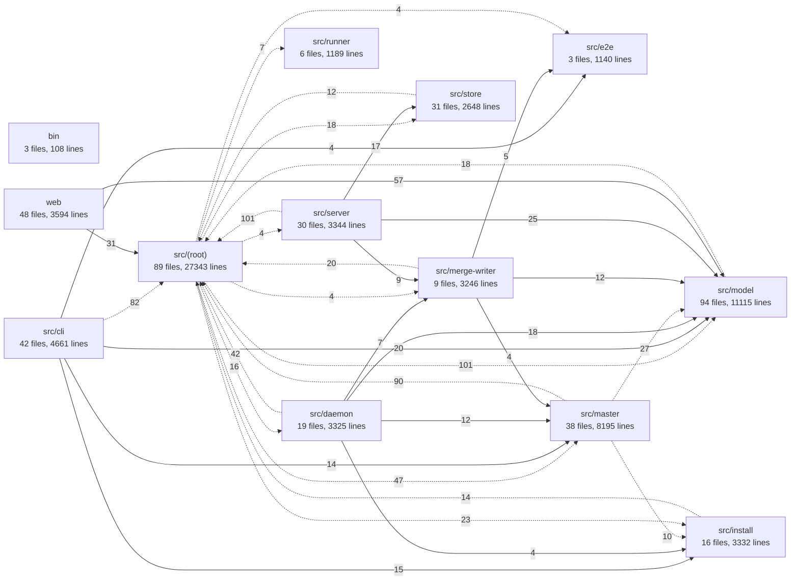

# Graphyard architecture review — 2026-10-31

Reviewed commit: **`3cebd2c26cf01842ac824dd3eb2ba7194745aae3`** (main tip, "GY-2994: a BLOCKED match skips the prompt's own wording"). Every `file:line` below refers to that commit. This review changes no behaviour. Its fixes are the `graphyard master create` payloads at the end, for the master to file.

## Summary (two-minute read)

Graphyard's core is sound:
- leases, epochs and the fleet-then-item lock order;
- one transaction per mutation, appending history;
- an append-only ledger;
- every route authenticated and role-checked;
- the browser bundle importing only pure model code.

The problem is what has piled up around that core. Over October, Graphyard moved to the "GitHub-light" design, where the loop's merge writer trial-merges and pushes `main` with a deploy key. In the same month it deleted release candidates, approvers, escalations, scope requests and risk lanes. Each of those deletions removed the *writer* of a fact but often left its *readers*, its schema and its tests in place. The code still evaluates states that nothing can produce any more.

The six problems that matter most:

1. **Candidate code can read the push credential.**
   - The merge writer's trial runs worker-authored code (`npm ci`, build, tests, `e2e.serve`) under the loop user with the loop's real `HOME` (`src/merge-writer/trial.ts:126-129`).
   - The deploy key that pushes `main` sits at `~/.config/graphyard/<install>/deploy-key` (`src/master/merge-writer-settings.ts:17`), readable from inside the trial.
   - The preview path already gives candidate code a throwaway HOME (`src/merge-writer/preview.ts:178-192`); the trial, which runs far more candidate code, does not. This is the only finding that is a safety issue.
2. **About 9,000 lines serve the retired GitHub-gated design and cannot run.**
   - In production, `up` always sets `merger: 'control-plane'`, so the GitHub App driver in `up.ts` (about 1,500 lines with `src/master-browser.ts`) is unreachable.
   - The reviewer-App credential, JWT and bind paths throw.
   - The Codex/agent review providers can never approve.
   - The bot-review wait in `auto-dispatch.ts` is never wired.
   - The mechanical-fix bot round has had no writer since GY-2010.
   - The base-break refresh reads a field nothing writes.
   - The engine's "merged" observation branch, the unauthorized-merge check and the direct-merge sweep act on `observation.merged`, which the only observer always sets to `false` (`src/merge-writer/local-observation.ts:96`).
3. **A 36-module import cycle** spans `daemon/`, `master/`, `merge-writer/`, `e2e/`, `producer.ts`, `reviewer.ts`, `up.ts` and `fleet.ts`.
   - One dynamic import closes most of it: `src/repository-setup.ts:302` → `up.ts`, used for one function. Cutting that edge alone shrinks the cycle to 19 modules.
   - The rest is closed by barrels (`src/master.ts`, `state.ts:211`) and helpers parked in the wrong module (`parseEnvValue` in `producer.ts`, `underTestRunner` in `supervisor.ts`).
4. **The `src/` root is a 27,000-line grab bag of 89 files.**
   - Five modules each mix six to seven concerns: `engine.ts` (2,447 lines, 199 KB), `reviewer.ts`, `up.ts`, `auto-dispatch.ts` and `supervisor.ts`.
   - `engine.ts` alone is about 50k tokens, which no agent reads in one pass.
5. **Facts held twice or more:**
   - What production serves: `ProductionWatch`, `Delivery`, a dead `ProductionDelivery`, `.graphyard/deploy.json` and `served.json`.
   - Which merges were reverted: kept only in the local loop cursor, which a reinstall archives.
   - Account exhaustion: a local file and registry observations.
   - The principal roster: `install.json`, `init --apply`'s `principals.json`, and `master principals`.
   - The idempotency receipt check: hand-copied about 30 times across 17 modules.
6. **The tests cost more than they protect.**
   - `tests/` (75k lines) is larger than `src/` (69k).
   - 113 test files each start their own embedded Postgres on a hand-picked port offset.
   - 1,041 exports are used only by their own file and by tests, which pins internals.
   - Tombstone, line-budget and incident-number tests guard nothing a reviewer wouldn't see.
   - A 1.3 MB captured-production fixture has no reader.

**Mechanical dead code:**
- 10 modules unreachable from any production entry point.
- 41 exports with no reference anywhere outside their own declaration.
- 93 unused imports and locals in `src/` (`tsc --noUnusedLocals`).
- 10 dead CLI commands and subcommands, 13 routes with no caller, 14 dead install flags, 5 retired config and environment settings.
- About 12 unused database columns and 4 unused tables.
- Ten "trusted contract" CI scripts whose workflows were deleted.

The fix list at the end has **41 items**: 22 deletions first, then 19 restructurings. Each has a stable id (D1–D22, R1–R19), listed in rank order. By value for effort, the first five are:
1. D1: delete the unreachable modules and the unreferenced exports;
2. D5: make complete require a head (today a PR-number submission strands the item);
3. D11: delete the held-release pin;
4. D12: delete the dead CI scripts and orphan fixtures;
5. D13: stop the per-merge advisory trial.

The larger GitHub-era removals follow: D3 (App/browser), D4 (reviewer App), D6 (merged observation and direct-merge sweep), D14 (dead production-delivery paths).

**Sandbox the trial (R1) first**, ahead of its rank among the restructurings: it is the safety finding.

## How this was reviewed

- **Imports.** A TypeScript-AST pass parsed all 886 tracked `.ts/.tsx/.mts/.mjs/.js` files (vendor excluded). It recorded:
  - every static import and re-export;
  - every literal dynamic `import()` and `tsImport()`;
  - namespace-import property uses;
  - every `src/…`/`bin/…` path a production file names as a string, such as spawned scripts.

  The graph, the cycles (Tarjan SCC over runtime edges, type-only imports excluded) and the diagram below are generated from that pass, not from the docs.
- **Reachability.** Computed from the production entry points: `bin/graphyard.mjs`, `bin/graphyard-verify.mjs`, `bin/held-release-hooks.mjs`, `src/cli.ts`, `src/server.ts`, `web/main.tsx`, `vite.config.ts`, `playwright.config.ts`, `integrations/*`, plus string-named paths. Only six dynamic imports take a computed path: `workspace-generated.ts` ×2, `install/local-runtime.ts`, `scripts/merge-authorization-server.mjs`, and two in tests. Each was read by hand.
- **Exports.** Re-exports through barrels (`src/model.ts`, `src/master.ts`, `src/master-daemon.ts`) were propagated. An export counts as *dead* when no module imports it and its name appears in no other tracked file, markdown and JSON included (a `git grep -w` per name, to catch string-based and dynamic use). An export counts as *test-only* when only `tests/`, `browser-tests/` or `e2e/` import it.
- **Unused locals.** `tsc --noEmit --noUnusedLocals` over the tsconfig.
- **Deep reading.** Six reviewers each read one area in depth: domain core, loop/daemon, master and runtimes, merge/review/proof, server/CLI/web/install, tests/scripts. I re-checked every high-severity claim against the code before writing it here:
  - `up.ts:1256`
  - `trial.ts:126`
  - `local-observation.ts:96`
  - `auto-dispatch.ts:1097` (no `headReviewers` writer anywhere)
  - `reviewer.ts:132` (no `mechanicalFix` writer)
  - `held-cli.json` (no writer)
  - `complete.ts:72`
  - `merge-settings.ts:13`
  - `server/auth.ts:217`
- **History.** Where a rule looked over-built, `git log -S`/`git log --` was used to find the incident it guards; that history is named next to the finding.

## Module dependencies as they are

Generated from the imports at the reviewed commit. Each box is a directory under `src/` (root files grouped as `src/(root)`) or a top-level folder. Each number is the count of import statements from one group into another. A dotted edge means the reverse edge also exists, so the two groups depend on each other. Edges with fewer than 4 imports are listed below the diagram rather than drawn.



Edges under 4 imports: bin → src/master (1), src/(root) → src/cli (2) ↔, src/cli → src/merge-writer (2) ↔, src/cli → src/daemon (2), src/cli → src/server (1), src/daemon → src/server (1), src/daemon → src/runner (2), src/e2e → src/model (2), src/e2e → src/(root) (3) ↔, src/e2e → src/install (2), src/install → src/model (3), src/install → src/master (2) ↔, src/install → src/server (2) ↔, src/master → src/runner (2) ↔, src/merge-writer → src/install (1), src/merge-writer → src/cli (1) ↔, src/model → src/master (2) ↔, src/runner → src/master (3) ↔, src/runner → src/(root) (1) ↔, src/runner → src/model (1), src/server → src/install (1) ↔, src/store → src/model (3).

How to read it:
- **`src/(root)` is a hub.** Almost every other group imports it and it imports almost every group, so the directory layout carries no layering.
- **`src/model` imports outward 20 times.** Most of these go through the `src/model.ts` barrel, which is harmless. The real breaks are `coordination.ts`, `project-applications.ts`, `provider-usage.ts`, `mechanical-findings.ts`, `master/base-break-refresh.ts` and the types of `pipeline-speed.ts`/`serve-app.ts`.
- **`src/store` imports `src/release.ts`** (`fs`/`child_process`) for its schema lineage.
- **`web` stays clean.** It reaches 68 `src` modules, all pure (`src/model/*`, `coordination.ts`, `herdr-connect.ts`, `project-applications.ts`). Its imports of `validation`, `delivery`, `scenarios` and `evidence-replay` are type-only, so the browser bundle pulls in no server code.

**Runtime import cycles** (strongly connected components; type-only imports excluded):

- **36 modules.** `master.ts`, `master/{config,harness,dispatch,environments,launch-account,runtime-prompt,connect-accounts,promotion,autonomy,loop-restart,attention,worktrees,branch-release}`, `daemon/{state,state-cursor,text,cycle-merge-writer}`, `merge-writer/{batch,executor,serve-revert,preview,trial,e2e-trial}`, `e2e/{steps,runner}`, `producer.ts`, `reviewer.ts`, `release-project.ts`, `request-settlement.ts`, `runner/roles.ts`, `fleet.ts`, `setup-from-zero.ts`, `master-browser.ts`, `up.ts`, `repository-setup.ts`.
- **3 modules each:**
  - `model/{bootstrap,evidence,mechanical-proofs}`
  - `model/{worker-preference,registry-sessions,registry}`
  - `master/profiles` ↔ `daemon/checkout-state` ↔ `supervisor`
  - `model/{actions,liveness,next-action}`
- **2 modules each:**
  - `model/loop-observation` ↔ `model/work`
  - `model/human-request` ↔ `model/human-proof`
  - `model/sessions` ↔ `model/session-state`
  - `install/local` ↔ `install/adapters`
  - `cli/park-command` ↔ `cli/session-commands`
  - `daemon/effects-production` ↔ `daemon/effects`

The 36-module cycle is closed by these edges (finding A3):
- **The setup back-edge:** `repository-setup.ts:302` dynamically imports `up.ts` for `readInstallLoopCode`. Cutting it alone leaves 19 modules.
- **The `master.ts` barrel,** imported from inside the cycle by `fleet.ts:7`, `master-browser.ts:7`, `request-settlement.ts:2`, `daemon/state-cursor.ts:6`, `producer.ts` and `reviewer.ts`.
- **The daemon state edges:** `daemon/state.ts:7` imports `mergeWriterStateSchema` from `cycle-merge-writer.ts`, and `state.ts:211` re-exports `state-cursor`.
- **Two single-helper edges:** `e2e/steps.ts:7` → `producer.ts` for `parseEnvValue`, and `master/dispatch.ts:23` → `reviewer.ts` for the string `simplicityParagraph`.
- **`master/config.ts:9,16-18`,** which is both the private-file primitive every module uses and the top-level `setupMaster` that imports `environments`/`attention`/`worktrees`/`repository-setup`.

## Dead code

**Verdicts:**
- **safe to delete:** the evidence check found no production reference.
- **needs check: X:** names the one further check to run first. These checks read production data, so the master runs them, not a worker.

Every whole-module entry was checked by graph reachability and by `git grep` for its basename, its path and its exported names across all tracked files.

### Unreachable modules (no production importer)

| File | Lines | Who still references it | Check | Verdict |
|---|---|---|---|---|
| `src/landable-check.ts` | 77 | nothing at all | not reachable; basename appears only in a captured fixture | safe to delete (GitHub check run, GY-887; retired by GY-2009/2010) |
| `src/rework-grounds.ts` | 50 | nothing at all | no importer, no string or dynamic reference | safe to delete (GY-1386 intervention fold, deleted in GY-2876) |
| `src/model/conflict-hotspots.ts` | 55 | nothing at all | no importer; basename appears nowhere | safe to delete |
| `src/model/user-bus.ts` | 4 | nothing at all | no importer; `userBusRefusal` appears nowhere else | safe to delete (blocker classes retired in GY-2875) |
| `src/runner/index.ts` | 8 | nothing at all | barrel; no importer in src, tests, scripts, bin or package.json | safe to delete |
| `src/codex-review.ts` | 141 | `tests/codex-review.test.ts` | last production importer removed in efca7d9bab (GY-2010) | safe to delete with its test, `tests/fixtures/codex-clean-result.txt` and `scripts/review-server.mjs` |
| `src/agent-review.ts` | 92 | `tests/review-provider.test.ts` | as above | safe to delete with its cases in that test |
| `src/cli/timing-failures.ts` | 44 | `tests/helpers/timing-report.ts`, which nothing imports | annotated a GitHub Actions check run | safe to delete both |
| `web/home-numbers.ts` | 32 | `tests/close-work.test.ts`, `tests/dashboard-simplification.test.ts` | not reachable from `web/main.tsx` | safe to delete with those cases |
| `src/playwright-reporter.ts` | 45 | `docker/runner/Dockerfile` only | that image is built by no workflow or install path | needs check: the validation-runner usage count (D21) |

### Retired subsystems that are still wired in but cannot fire

Each of these is reachable, so reachability alone does not flag it. The check, in every case, was to find the writer of the state it acts on and confirm the writer is gone.

| Subsystem | Where | Why it cannot fire | Retired by | Verdict |
|---|---|---|---|---|
| GitHub App driver, App page, manifest and Mobile reprompts in `up` | `src/up.ts:685-860, 1261-1545, 1771`; `upSteps` | `upRequestFromArgs` always sets `merger: 'control-plane'` (`up.ts:1256`), and everything sits behind `!upMergerControlPlane` | GY-1552, hotfix df9a364826 | safe to delete |
| `master browser` flows | `src/master-browser.ts` (1,200 lines), `src/cli/master/fleet.ts:32-41` | `observeInstallation` throws without a reader, and the only caller passes none; `controlPlanePermissions = {}` (`master-browser.ts:30`) | GY-2010 | safe to delete (keep `actionsDirectory` for `promotion.ts`) |
| Reviewer GitHub App: credential, JWT, mint, bind, verify | `src/reviewer.ts:38-45, 398-439, 1641-1644`; `src/cli/master-reviewer.ts:8-36` | `mintReviewerToken` and `verifyReviewerInstallation` throw "removed"; non-plane `launchReview` branches need `observation.source !== 'control-plane'`, which nothing produces | GY-2010 | safe to delete |
| Reviewer thread follow-up filing | `reviewer.ts:1549-1625` (`followUpThreadIds`, `threadResolutionAttempts`, `followUpFilingBoundMs`, `approvesCurrentHead`, `approvesFinalHead`) | zero callers | GY-2010 | safe to delete |
| `appPermissions`, `reviewerApps`, `controlPlaneAppId` | `master/attention.ts:14,122-133`; `model/setup-checklist.ts:85-93`; `master/config.ts:269`; `server/main.ts:39`; `server/auth.ts:211`; `server/routes/status.ts:67`; `install/index.ts:414` | no route produces `appPermissions`; `controlPlaneAppId` is never set | efca7d9bab | safe to delete |
| Engine merged-observation branch and unauthorized-merge check | `src/engine.ts:267-285, 2384-2433` | the only observer, `observeLocalHead`, returns `merged: false` (`merge-writer/local-observation.ts:96`); deliveries are written by `server/merge-record.ts:147-158` | 789dc8a86c (GY-2010) | needs check: no open item carries an unauthorized-merge text in `violations` |
| Direct-merge sweep and `operator direct-merges` | `src/direct-merge.ts`, `src/cli/direct-merges.ts`, their routes; swept every reconcile (`engine.ts:2081`) | acts only on `unauthorizedMergeViolation`, which only the dead branch above pushes | GY-2010 | needs check: as above |
| PR-form submission | `src/cli/complete.ts:72`; `engine.ts:620-637, 698-716, 1241-1245`; `status.ts:186` `?pr=` | `complete` without `--head` sends `{pr}`, and the item then waits on "no submission to observe" forever (`server/control-plane-observation.ts:25-27`) | GY-2010 | safe to delete (require `--head`) |
| Codex/agent review providers | `engine.ts:1631-1697` (`bindReviewRequest`, `failoverReviewRequest`, zero callers); `model/review.ts:6`; `model/policy.ts:32`; `model/gates.ts:88-100`; `daemon/rework.ts:26`; `next-action.ts:225` | nothing writes `observation.agentReview`, so an item with `reviewProvider: 'codex'\|'agent'` never passes review | 789dc8a86c | needs check: no open item has those providers |
| Bot-review wait | `src/auto-dispatch.ts:164, 332-377, 1080-1135` (`defaultAwaitReviewers`, `botLimitNotice`, `botReviewerStates`, `awaitingBotReview`, `botReviewPullLimit`); `run.awaitReviewers`/`awaitReviewersMinutes` (`master/profiles.ts:307`, `master/config.ts:334`); `master/instructions.ts:35` | `dispatchEffects` never supplies `headReviewers` or `botActivity` (no writer anywhere in `src`), so the block at `:1097` never runs | efca7d9bab | safe to delete |
| Mechanical-fix bot round (GY-971) | `src/mechanical-findings.ts:39-322`; `reviewer.ts:29,132,1042`; `master/dispatch.ts:6`; `model/gates.ts:6,100`; `engine.ts` `mechanicalplan` | nothing assigns `mechanicalFix` (`reviewer.ts:132` is the schema only); `observation.reviews[].mechanical` is never filled | 7dfe7033ad (GY-2010) | safe to delete (keep the nit classification text the review prompt uses) |
| Base-break refresh (GY-793) | `src/master/base-break-refresh.ts`; `model/next-action.ts:13,228`; `model/base-refresh.ts:42` | `readBaseBreak` (the only producer) has no callers; nothing writes `observation.baseBreak` | GY-2010 | safe to delete (move `failedTestsFromLog` to the test helper, its only user, or delete it with `timing-report.ts`) |
| Held-release pin | `bin/graphyard.mjs:13-45`, `bin/held-release-hooks.mjs`, `src/daemon/held-cli.ts`, `master/loop-restart.ts:45`, `supervisor.ts:932-980`, `install/units.ts:194`, `master/profiles.ts:515`, `repository-setup.ts:673-693` | nothing writes `.graphyard/held-cli.json` (writer removed in 64dc3462f2, GY-2877); a stale pin silently runs every command on an old snapshot (the GY-2169/2179 trap) | GY-2877 | safe to delete (one-time removal of a stale pin) |
| `ProductionDelivery` | `src/production-delivery.ts`; built in `server/auth.ts:217` | no route calls it | cb1148cde3 | safe to delete |
| `ProductionWatch` GitHub paths | `src/production-watch.ts:91-121` and the `contains`/`aheadBy` memos | the only constructor passes `github: null` (`server/main.ts:47`) | GY-2010 | safe to delete |
| `Delivery` promotion and verification | `src/delivery.ts:786-830` (`observeLive`, `candidateVerification`, `candidateEnvironment`) | `release.candidate.promotion` is never written | GY-1983 | safe to delete; the rest of `Delivery` needs check: `delivery_environments` row count |
| Merger mode | `src/merger-mode.ts` (`MergerMode = 'control-plane'`, `AutoMergeSettings`, `/api/auto-merge`), `cycle-merge-writer.ts:641,804`, `effects-production.ts:177` | the merger port returns a constant; per its own comment, auto-merge "holds nothing" | GY-2874 | safe to delete (keep `sshOrigin`) |
| Merge-conflict rework | `daemon/rework.ts:98,157` `syncConflict` | `observation.conflicting` has no writer | GY-2010 | safe to delete |
| Advisory post-merge trial | `daemon/cycle-merge-writer.ts:226-318,790`; `scripts/ci-tests.mjs:39` `advisoryTests = []` | runs a full trial per merge; the outcome is one `console.error` line | GY-2086 made it log-only | safe to delete |
| Release-candidate contract in E2E | `src/e2e/case.ts:212-257`, `e2e/runner.ts:587-625` (`checkoutContract`, `pendingOutcomes`, `rc-` run ids, the `merger === 'github'` message), `e2e/contract.json` | no caller passes `contract` | GY-1983 | safe to delete |
| `runServeRevert` | `src/merge-writer/serve-revert.ts:221` | only tests call it; production uses `serveRevertAttempt` (`cycle-merge-writer.ts:615`) | GY-2990 | restructure (R3), don't just delete |
| Provider usage parsers | `src/provider-usage.ts:63,131,452` | `adapter.getUsage()` is called without a response, so `parse` is never reached; `environment-quota.ts` parses the same data again | — | safe to delete; the tests need updating |
| `observation-priority.ts` leftovers | `:14,38,75` | no references | — | safe to delete |
| `regression-guard.ts` `threeWayMerge` | `:23-129` | served the deleted `github.ts decideLandingMerges` | GY-2010 | safe to delete |
| GitHub-era readiness text | `src/readiness.ts:108-113,135,166`; `master/config.ts:269`; `src/setup-from-zero.ts:183-193,282` | they recommend a `pull_request` workflow, `graphyard reviewpolicy`, `graphyard github-setup --update-permissions` and a release token, none of which exist; `github-app`/`reviewer-app` doctor lines always pass and point at a deleted step 4 | 6fabe05aa0, GY-1983, GY-2010 | safe to delete |

### Exports with no reference anywhere

Each export below has no importer, and its name appears in no other tracked file (`git grep -w`, docs and fixtures included). It is also not used inside its own file beyond its declaration. **Verdict for every row: safe to delete.** The four GitHub-shaped entries go with their subsystem above.

| Location | Symbol | Kind |
|---|---|---|
| `src/attribution.ts:379` | `AttributionReport` | [type] |
| `src/cli/verify.ts:186` | `baseExercise` | [value] |
| `src/e2e/case.ts:241` | `checkContract` | [value] |
| `src/evidence-reuse.ts:24` | `ReuseCategory` | [type] |
| `src/generated-files.ts:32` | `isGeneratedFile` | [value] |
| `src/harness.ts:371` | `refusedLaunchKinds` | [value] |
| `src/harness.ts:376` | `assertLaunchRecipe` | [value] |
| `src/install/limits.ts:29` | `readDeployedDelegationLimits` | [value] |
| `src/install/transport.ts:83` | `sshTransport` | [value] |
| `src/master-browser.ts:657` | `signalSudoSettled` | [value] |
| `src/master/base-break-refresh.ts:137` | `readBaseBreak` | [value] |
| `src/model/action-progress.ts:76` | `actionStallLatencyMs` | [value] |
| `src/model/action-progress.ts:271` | `stalledActions` | [value] |
| `src/model/actions.ts:102` | `actionRenewIntervalMs` | [value] |
| `src/model/agent-requests.ts:59` | `AgentRequestInput` | [type] |
| `src/model/closed-question.ts:164` | `accuracyStudy` | [value] |
| `src/model/delivery-policy.ts:23` | `DeploymentAdapterName` | [type] |
| `src/model/loop-owned.ts:47` | `loopHeldBlocker` | [value] |
| `src/model/merge-ledger.ts:17` | `MergeLedgerKind` | [type] |
| `src/model/merge-ledger.ts:43` | `MergeIntent` | [type] |
| `src/model/merge-ledger.ts:44` | `MergePushed` | [type] |
| `src/model/merge-ledger.ts:46` | `MergeRefused` | [type] |
| `src/model/plain-status.ts:292` | `byAttention` | [value] |
| `src/model/release.ts:86` | `ExactCandidate` | [type] |
| `src/model/release.ts:100` | `exactCandidateKind` | [value] |
| `src/model/release.ts:101` | `candidateValidationKind` | [value] |
| `src/model/release.ts:103` | `candidateIdentityText` | [value] |
| `src/model/release.ts:106` | `candidateSource` | [value] |
| `src/model/repository-policy.ts:49` | `RepositoryPolicyInput` | [type] |
| `src/model/repository-policy.ts:205` | `repositoryPolicySource` | [value] |
| `src/model/timing-companion.ts:88` | `judgeTimingCompanion` | [value] |
| `src/observation-priority.ts:14` | `reviewCadenceCapMs` | [value] |
| `src/observation-priority.ts:38` | `observationHeadCount` | [value] |
| `src/observation-priority.ts:75` | `observationClaimOrder` | [value] |
| `src/production-delivery.ts:117` | `verifyPromotedDigests` | [value] |
| `src/project-applications.ts:23` | `applicationKinds` | [value] |
| `src/protection.ts:4` | `protectionRun` | [value] |
| `src/regression-guard.ts:85` | `threeWayMerge` | [value] |
| `src/review-cap.ts:74` | `observedReviewBody` | [value] |
| `src/runner-attestor.ts:13` | `SupervisionRequest` | [type] |
| `src/runner-collector.ts:196` | `artifactKindsFor` | [value] |
| `src/runner/payloads.ts:78` | `PiRuntime` | [type] |
| `src/runner/registry.ts:56` | `registeredRunFor` | [value] |
| `src/runner/registry.ts:61` | `watchedRuns` | [value] |
| `src/server/review-verdict.ts:272` | `withdrawReviewVerdict` | [value] |

Three near-misses were checked by hand:
- `refusedLaunchKinds` (`harness.ts:371`): its only other occurrence is unrelated prose in a doc. Delete it.
- `reviewCadenceCapMs`: its only other occurrence is in a captured fixture. Delete it.
- `protectionRun`: only `research/github-gates-inventory.md` mentions it. Delete it.

Six further exports are matched only by unrelated same-name symbols, and are also safe to delete:
- `install/runtimes.ts:63` `reviewerProfiles`
- `model/session-launch-window.ts:40` `launchingSession`
- `model/session-state.ts:68` `unseenSessions`
- `server/receipts.ts:10` `findWork` (`waits` and `closed-question` define their own)
- `store/snapshot-delta.ts:207` `documentBefore` (only the dead engine branch uses a local of that name)
- `model/sessions.ts:275` `elapsed`: test-only, `elapsed` is a common local name

Also safe to delete, from the deep read:
- `store/store.ts` `holdJob`, `refuseJob`, `releaseHeldJobs`, `retryJob` and `heldJobs` (always empty once those go).
- `store/schema.ts:81` `newerSchema`, a duplicate of `migration-locks.ts:57`.
- `model/release.ts:71-106`, the candidate types.
- `auto-dispatch.ts` `reviewerReminderBoundMs`, `tickRetryMinMs`.
- `daemon/rework.ts` `reworkObservationWait`, `observationWakeDue`, `mergeableCandidate`.
- `daemon/text.ts` `detailChanged`, `namePaths`.
- `daemon/liveness.ts` `cycleFailureAttentionAfter`.
- `daemon/reconcile.ts` `closeKey`.
- `daemon/hotspots.ts` `hotFileSet`.
- `runner/roles.ts:23` `confiningSpawn`: needs check, that GY-888 confinement is covered elsewhere before its single test goes.
- `server/review-verdict.ts:272` `withdrawReviewVerdict` (its route went in GY-2874).
- The candidate-promotion readers of `Engine.claimNextAction`/`settleClaimedAction`/`renewClaimedAction` (`engine.ts:1433-1505`): no route has exposed them since GY-1984, and only tests call them.

### Unused imports and locals

`tsc --noUnusedLocals` reports 93 in `src/` and 171 in tests. The heaviest files are `master/launch-keyring.ts` (30), `engine.ts` (14) and `master/worktrees.ts` (11).

In `engine.ts`, the unused imports are `criterionSchema`, `bindingApproval`, `carriedApproval`, `currentEvidence`, `decideCarry`, `exactApproval`, `pathScopeContains`, `requiredProofs`, `reviewerProfileSchema`, `reviewProviders`, `OperatorCapability`, `sessionKind` and `onto`, plus the local `previousObservation` (`:2404`).

Safe to delete. Turning on `noUnusedLocals` keeps them out (D2).

### Exports only tests import

1,041 exports are used by their own file and by tests, and by no other production module. These are test seams; most are legitimate, and they are not dead. A further 83 exports are imported **only** by tests and have no use in their own file. For those, the test pins a value or function production never uses. Notable ones:
- `onboarding.ts:241` `writeDeliveryWorkflow`: writes a GitHub workflow. Safe to delete.
- `protection.ts:26` `readWorkflow`: only asserts that `release.yml` has no `pull_request` trigger. Safe to delete.
- `release.ts:24` `nextDateVersion`: needs check, whether any release step tags dated versions.
- `model/repository-policy.ts:207` `setRepositoryPolicy` (15 tests): a fixture writer. Move it to `tests/helpers`.
- `install/units.ts:59,207` `ownedUnits`, `assertUnitOwned`: safe to delete with the test.
- `install/transport.ts:120` `fakeTransport`: move it to `tests/`.
- `store.ts` `events()`, `list()` (63 test files): move them to `tests/helpers`.
- `daemon/liveness.ts` `hostPidProbe`, `daemon/reconcile.ts` `candidateKey`, `daemon/sessions.ts` `readyToRetry`: needs check, drop each with its single test.
- `runner/payloads.ts:54` `diagnosticianSettings`: GY-2186 retired the diagnostician. Make the schema `z.unknown()` so old `master.json` files still parse.

The others (cache resets `clearPlanUsageCache`, `clearRuns`, `clearBaseTipCheckCache`; idle hooks `mergeWriterIdle`, `advisoryIdle`) are deliberate seams. Keep them.

### Unused CLI commands

Every command dispatched from `src/cli/index.ts` and `src/cli/*` was checked for an invoker: production spawns, generated prompts and guides, docs, units, scripts, then tests.

| Command | Evidence | Verdict |
|---|---|---|
| `master merge` | prints a constant ("GitHub merges") that contradicts `mergeAnswer` (`cli/master/operations.ts:22`); tests only | safe to delete |
| `master reviewer setup` | `startGithubSetup` throws "removed", after `mkdir`-ing the credential directory | safe to delete |
| `master reviewer bind` | binds a GitHub App id and PEM; only stale remedy strings and tests use it | safe to delete |
| `master browser app-permissions\|installation-accept\|capture\|fixtures` | see `master-browser.ts` above | safe to delete |
| `master principals [--apply]` | reads `.graphyard/credentials.json`, which nothing writes; `--apply` is ignored; no docs, no tests | safe to delete |
| `scenario FILE` (singular) | no references; `e2e sync` replaced it | safe to delete |
| `operator direct-merges` | see the direct-merge sweep | needs check: as the engine merged branch |
| `master adopt` (not in help) | no references | needs check: whether the GY-1849 Huck migration still uses it |
| `register` | no references | needs check: external workspace registration |
| `runner account-digest`, `runner verify-report`, `validation capacity`, `validation artifact-migrate`, hidden `validation artifact-upload\|artifact-download\|show-candidate\|definitions` | no references outside their help text | needs check: D21's usage count |

### HTTP routes with no caller

The CLI, `web/`, runners, scripts and tests were searched for each route.

| Route | Where | Verdict |
|---|---|---|
| `POST /api/merge-queue` | `server/routes/merge-settings.ts:13-21`, "accepted and ignored" | safe to delete |
| `POST /api/auto-merge` | `merger-mode.ts` | safe to delete |
| `POST /api/production-environment` | `server/routes/status.ts:112-124`; the loop's call was removed in GY-2877, yet `/api/status` and `/api/board` still read the stale ledger value | safe to delete with the reader |
| `GET /api/events/stats` | `status.ts:219` | safe to delete |
| `GET /api/actions` | `server/routes/actions.ts:18`; client removed in GY-1984 | safe to delete |
| `GET /api/analytics/attribution[/drilldown]`, `GET /api/attribution/manifest/:id/:n`, `GET /api/attribution/work/:id` | `server/routes/attribution.ts:23,33,43`; client removed in GY-2876 | safe to delete |
| `GET /api/validation/import/seal-authority` | `server/routes/validation.ts:28` (release filing, GY-1882) | safe to delete |
| `GET /api/agent-registry/connect/hosts` | `server/routes/agent-registry.ts:170` | safe to delete |
| `GET /api/delegation`, `POST /api/intake`, `POST /api/work/:id/lead-ruling` | `server/routes/delegation.ts:10-12`; `slice-lead` cannot be minted by `principal add` or `install` | needs check: no roster entry has role `slice-lead` |
| direct-merge routes | see the direct-merge sweep | needs check: as above |

`src/server/routes.ts:79`: `registerApiRoutes` is an identity function, and its comment names a `routes/candidates.ts` that does not exist. Safe to delete.

### Unused config fields, flags and environment variables

- **`graphyard install` flags parsed and never read** (`src/install/index.ts:97-107`): `--ssh-host`, `--ssh-user`, `--ssh-key`, `--server-type`, `--location`, `--workspace`, `--target`, `--migrate`, `--max-monthly`, `--confirm-price`, `--logs`, `--herdr-only`, `--profiles-only`, `--fresh-cursor`. These belonged to the railway, hetzner, host and helm providers deleted in 903694608e. Safe to delete.
- **Install values computed and never read:** `requiredChecks` and `reviewCount` (`install/index.ts:356-363`, branch protection). The `--review-policy github` default (`:319`). `deployment.sshHost`/`sshUser`, always null and `'root'` (`install/secrets.ts:59`). Safe to delete.
- **Master config** (`src/master/profiles.ts`):
  - `mergeMethod` (`:405`) is written and never read. Safe to delete.
  - `mergeQueue.rerunFailedChecks` and `rerunFailedChecks()` (`:418-426, 482`). Safe to delete.
  - `githubAppId` is still required. Needs check: make it optional; existing files still parse.
  - `diagnostician` (`:352`). Turn it into `z.unknown()`.
  - `run.awaitReviewers`/`awaitReviewersMinutes`. Safe to delete.
- **Environment:**
  - `GRAPHYARD_REVIEWER_APPS` and `GRAPHYARD_RELEASE_TOKEN`: retired features. Safe to delete.
  - `GRAPHYARD_PRODUCTION_BRANCH` (GY-1207 release branch). Needs check: no install sets it.
  - `GRAPHYARD_UAT_STATIC`/`GRAPHYARD_UAT_BUILD`: see A9.
  - `GRAPHYARD_DATABASE_POOL_SIZE`, `GRAPHYARD_ATTESTOR_*`: read but documented nowhere and set by no installer.
  - `GITHUB_PRIVATE_KEY`/`GITHUB_WEBHOOK_SECRET` scrub in `supervisor.ts:431`: harmless.
- **`graphyard.json` sensitive globs that match nothing:** `src/merge-queue.ts`, `src/main-guard.ts`, `migrations/`, `compose.yml`. Safe to delete.
- **`init --delivery release-candidate|per-pr`** (`onboarding.ts:460`): the default applies only when the merger is not the control plane. Safe to delete.

### Unused database columns and tables

DDL lives in `src/store/schema.ts` and `src/store/tables/*`. Each column was checked for a reader and a writer outside its DDL. Deleting DDL creates a new schema generation (GY-1961). That costs one appended digest; take it once for the whole batch (A13).

| Column / table | Evidence | Verdict |
|---|---|---|
| `jobs.refreshed_until` | never written; read only into an ignored `takeJob` field | safe to delete |
| `jobs.held_on`, `jobs.refusals` | written only by the dead `holdJob`/`refuseJob` | safe to delete with those |
| `jobs.held_until`, `jobs.held_reason` | same writers; still read by `engine.observationJob` and the snapshots | safe to delete together with those reads |
| `work_index.owner`, `epoch`, `next_action` | written by the trigger, never read | safe to delete |
| `work_index.pr`, `pr_state` | read only by the `?pr=` lookup and a compaction guard for "merged but not done", which only the dead engine branch creates | needs check: delete after D5 and D6 land |
| table `merger_default_pin` | never read; its DDL inserts a `github` merger event | safe to delete through `retiredTables` |
| tables `production_observations`, `production_observation_merges`; indexes `events_delivery_repository_instant`, `events_delivery_first` | no writer and no reader | safe to delete |
| tables `lead_rulings`, `intake_items` | written, never read; the ruling also lives in `work.leadHold` | needs check: no `slice-lead` principal and no intake rows |
| `change_numbers.allocated_at`, `graphyard_schema.applied_at` | audit only | keep |

### Retired compatibility paths

- **`src/model/retired-queue.ts`.** `dropRetiredQueueFields`/`dropRetiredScopeFields` run on every `evaluate` (`engine.ts:1704`), every write (`store/document-write.ts:13,30`), the status read (`status.ts:197`) and `actions.ts:210`, to strip fields retired between GY-1236 (10-05) and GY-2876 (10-22). A one-shot `UPDATE work_items SET document = document - ARRAY[...]` replaces all of them. Needs check: `SELECT count(*) FROM work_items WHERE document ?| ARRAY[<fields>]`, run before and after.
- **`retiredField` in the create/requirements schemas** (`engine.ts:65-73`). Keep it until no CLI older than GY-1992 talks to a server: an old CLI still sends `plannedFiles`, and `examples/work.json` still carries `plannedFiles` (`createSchema` alone refuses it).
- **`daemonStateSchema`** carries about 25 `retired`/`z.unknown()` keys (`daemon/state.ts:156-184`). `reconcilePendingActions` keeps branches for the retired `scope`, `deployment`, `fault` and `judgement` kinds (`daemon/reconcile.ts:43-70`). Parse with `.strip()` and drop those branches. Safe once the cursor is rewritten.
- **`RunRole 'research'`** (`runner/registry.ts:21,65,93,213,260`): research runs were retired in GY-2875. Safe to delete.
- **`retiredTables`** dropped on every startup (`store/schema.ts:30`). `summaryOmitted` still lists `researchBrief`. `evaluate` nulls `mergeAuthorization` (`engine.ts:1708`). Safe to delete after one release.
- **Control-plane observations saved as kind `github.observed` with actor `github`** (`engine.ts:2443`). Deliveries are now saved as `merge-writer.delivered`, so `DELIVERY_EVENT_PREDICATE` and the compaction "cited revision" guard (`store/compaction.ts:62,77`) protect nothing, and `delivery.authorizationRevision` is written but never read. Needs check: rename the event kinds with a ledger-compatible migration.
- **`MERGE_PROTOCOL = 3`** (`src/protocol-version.ts`) is frozen by its own comment. Keep it.
- **`.github/workflows/release.yml`** triggers on `v*.*.*` tags. Releases are dated tags (`2026.10.18.1`), so it never runs. `DEFAULT_IMAGE` (`src/release.ts:96`, `install/adapters.ts:12`) reaches only the `local` provider, which runs no image. Safe to delete.

### Dead scripts, fixtures and committed artefacts

| Path | Evidence | Verdict |
|---|---|---|
| `scripts/{contracts,acceptance-contract,herdr-recovery-contract,merge-authorization-contract,merge-authorization-probe,merge-authorization-server,case-inventory,unit-contract,run-acceptance,run-unit-acceptance,prepare-acceptance}.mjs` (about 810 lines) | no caller in src, package.json, deploy or `.github`; the workflows calling them were deleted (892c0d02fd GY-2009, 5ab2546da3 GY-1983); only `tests/ci-proofs.test.ts` and `tests/herdr-recovery.test.ts:13-15,96-114` read them | safe to delete (move the herdr-recovery exercise into its test) |
| `scripts/resolve-thread.mjs` | resolves GitHub PR review threads; only a harness rule (`src/harness.ts:531,559`) names it | safe to delete with the rule |
| `scripts/seed-dogfood.mjs` | no caller; seeds "GitHub App"/"merge broker" items | safe to delete |
| `scripts/review-server.mjs` | only `tests/codex-review.test.ts` uses it | safe to delete |
| `scripts/graphyard-pull.mjs` + `auto-dispatch.ts:1550-1576` `runWorkerPull` | pull-model worker CLI (GY-87); only `tests/action-queue.test.ts:22,370-378` uses it | needs check: no executor or doc flow uses the pull model |
| `scripts/ci-tests.mjs` `select`/`runContext`/`selectForRun`/`speculativeTipSubject`/`shards` (`:25-26,160-211`) | read `GITHUB_EVENT_NAME`, `GITHUB_STEP_SUMMARY` and `refs/graphyard/queue/*`; the merge writer uses only `affected` (`trial.ts:959`); the `select` fallback (`trial.ts:963-968`) is for pre-GY-1522 trees | safe to delete |
| `tests/fixtures/gy-1389-hand-reworks.json` (1.3 MB captured production) | no reader since efca7d9bab | safe to delete |
| `tests/fixtures/gy-1403-stalled-gate.json`, `tests/fixtures/github-confirm-access-authenticator.html`, `tests/fixtures/goal-compose-preview/` | no reader | safe to delete |
| `tests/helpers/held-account-loop.ts`, `tests/helpers/merge-instants.ts`, `tests/helpers/timing-report.ts` | no importer | safe to delete |
| `browser-tests/screenshots/before/` | no reader (PR-attachment era) | safe to delete |
| `browser-tests/screenshots/after/`, `login/` | rewritten by `screenshots.spec.ts:15` and `fleet-settings-declutter.spec.ts:16`, so running the browser suite dirties the checkout; `tests/ui-login.test.ts:215` asserts they are committed | write them to a gitignored directory instead (D12) |
| `research/github-gates-inventory.md`, `research/rooflow-lessons.md` | no reader; superseded by the GitHub-light direction | safe to delete |
| `design/dashboard/*.dc.html` | referenced only by comments in `web/pages/workers.tsx` and `web/style.css` | needs check: whether anyone still designs from them |
| `eval/golden` + `scripts/eval-golden.ts` | manual tool (GY-2970, 10-28), documented in `docs/development.md:28-34`, never run | keep; reassess in a month |

## Architecture findings

Severity:
- **high:** causes failures, safety exposure, or large wasted work now;
- **medium:** slows every change in its area;
- **low:** local cleanup.

Effort: S under a day for one agent, M one to three days, L more.

### A1. Candidate code can read the deploy key and coordinator credentials (high, S for HOME, M for a real sandbox)

- **Where:**
  - `src/merge-writer/trial.ts:126-129`: `trialEnvironment` removes credential-bearing *variables*, but keeps `HOME` through `isolatedTestEnvironment` (`src/cli/test-isolation.ts:34`).
  - That environment runs `npm ci` lifecycle scripts, `npm run build`, the tests and `e2e.serve` (`merge-writer/e2e-trial.ts:52`), all as the loop user.
  - The deploy key is `~/.config/graphyard/<install>/deploy-key` (`master/merge-writer-settings.ts:17`). The coordinator credential files and the gh config sit beside it.
- **Cost:** a worker's test or build script can read the key that pushes `main`, and the coordinator token. AGENTS.md says workers never get trusted credentials. Review happens before the trial, but a reviewer is not a sandbox.
- **What exists already:** the preview path already gives candidate code a throwaway HOME and XDG directories (`preview.ts:178-192` `previewEnvironment`), and `src/worker-sandbox.ts` already confines worker sessions.
- **Simpler shape:**
  - Build the trial environment from `previewEnvironment`, with a fresh HOME per trial.
  - Run the trial's children under the worker sandbox (bwrap), with `~/.config/graphyard` and the loop's runtime directory masked. The HOME change alone still leaves the absolute path readable by the same Unix user.
- **History:** GY-1548 added the variable scrub after an echoed environment leaked a token. The file-path exposure was never covered.

### A2. Retired GitHub-era machinery is still evaluated on every pass (high, M in total, split into D3–D11)

- **The tables above list it:** the App driver, browser flows, reviewer App, codex/agent providers, bot wait, mechanical round, base-break refresh, merged branch, direct-merge sweep and held-release pin.
- **Cost:**
  - Roughly 9,000 lines of production code and their tests.
  - Every `evaluate` runs `mechanicalReviewHold` (`gates.ts:100`) and `baseBreakWait` (`next-action.ts:228`).
  - Every reconcile pass runs a direct-merge read and sweep (`engine.ts:2081`).
  - Every dispatch tick runs the bot-wait branch test.
  - Master instructions describe a bot wait that does not exist (`master/instructions.ts:35`).
  - Operators are told to run commands that do not exist (`config.ts:269`, `readiness.ts:135`).
  - A `complete` without `--head` strands the item forever (`cli/complete.ts:72`).
- **Root cause:** each simplification deleted the writer and kept the readers "so old documents still parse".
- **Simpler shape:** delete them. Where a stored document may still carry a field, use one data migration, not a permanent reader. That is the same idea as A13.

### A3. The 36-module runtime cycle and the barrels that create it (medium, S for the main cut, M in total)

- **Where:** the cycle is listed under "Module dependencies". Its back-edges:
  - `repository-setup.ts:302` dynamically imports `up.ts` for `readInstallLoopCode`.
  - The `master.ts` barrel is imported from inside the cycle (`fleet.ts:7`, `master-browser.ts:7`, `request-settlement.ts:2`, `daemon/state-cursor.ts:6`, `producer.ts`, `reviewer.ts`).
  - `daemon/state.ts:7` imports `mergeWriterStateSchema` from `cycle-merge-writer.ts`.
  - `state.ts:211` re-exports `state-cursor` "so every existing import keeps working".
  - `text.ts:2` imports `state.ts` for one constant.
  - `e2e/steps.ts:7` imports `producer.ts` for `parseEnvValue`.
  - `master/dispatch.ts:23` imports `reviewer.ts` for `simplicityParagraph`.
  - `master/config.ts` mixes leaf primitives (`privateFile`, `atomicPrivateWrite`, `readCredentialFile`) with the top-level `setupMaster`.
  - Four small barrels: `environments.ts:26-27`, `worktrees.ts:265`, `autonomy.ts:125`, `profiles.ts:572`.
- **Cost:**
  - Load order matters. `daemon/state.ts` relies on `z.lazy`, and its comment `// lazy: it imports this module` describes a static import.
  - `up.ts` has eight and `repository-setup.ts` four dynamic `import()` calls that exist only to dodge the cycle.
  - A test of `e2e/steps.ts` loads the producer, reviewer, master and merge writer.
  - Nothing can be split out of this group without touching all of it.
- **Simpler shape:**
  - Move `readInstallLoopCode` into a leaf module. That alone takes the cycle from 36 to 19 modules.
  - Move `mergeWriterStateSchema`/`advisoryStateSchema` into `daemon/merge-writer-state.ts`, and `actionDetailMax` into `text.ts`. Merge `state-cursor.ts` back, or invert the direction.
  - Move `parseEnvValue` into `src/env-file.ts`, the review prompt sections into `src/review-prompt.ts`, and the private-file helpers into `src/private-file.ts`.
  - Inside `src/`, import `src/master.ts` only from `src/cli/**`, and delete the four small barrels.
  - The `supervisor.ts` ↔ `profiles.ts` ↔ `checkout-state.ts` cycle closes because `underTestRunner`/`temporaryDirectories` live in `supervisor.ts:710,731`. Thirteen modules import them, and `underTestRunner` is redefined privately in `up.ts:1469`, `repository-setup.ts:534` and `install/units.ts:74`. Move both helpers to a leaf module.

### A4. `engine.ts` holds seven concerns (medium, L)

- **The seven concerns** (`src/engine.ts`, 2,447 lines, 199 KB):
  1. Command schemas and a 490-line `if (command === …)` chain (`:863-1354`).
  2. Lease renewal faults and grace, and plane liveness/stall/deploy events (`:293-330, 780-862, 1865-2010`).
  3. The action-queue executor API (`:1418-1630`).
  4. The dead review binding (`:1631-1697`).
  5. Observation intake (`:620-720, 2350-2447`).
  6. The incremental reconcile scheduler, about 850 lines (`:328-585, 1747-2350`).
  7. `evaluate`/`recordDispatch`.
- **Problems inside it:**
  - The heartbeat is written twice (`:876-894` and `:1052`).
  - `server/merge-record.ts:189` casts the engine to reach the private `recordDispatch`.
- **Cost:**
  - At about 50k tokens, no agent reads the file whole, and every item touching a command edits the same file.
  - `engine.ts` is the most-changed file in `src/` since 2026-10-01: 181 of 3,571 non-merge commits touched it, ahead of `daemon/effects.ts` (169) and `daemon/cycle-decisions.ts` (122). Concurrent items therefore collide on it more than on any other file.
- **Simpler shape:**
  - `engine/commands/*.ts`: one handler per command in a table, sharing receipt, authorisation and save wrapping.
  - `engine/leases.ts`, `engine/actions.ts`, `engine/observe.ts`, `reconcile/`.
  - `evaluate` and `recordDispatch` exported from a module that `merge-record` imports.
- **Order:** do the deletions (D5, D6, D7, D16) first. They remove about 400 of these lines.

### A5. `auto-dispatch.ts` and `supervisor.ts` each mix unrelated subsystems (medium, M each)

- **`auto-dispatch.ts`** (1,576 lines) holds:
  - a second local cursor, with its own schema, repair and persistence (`:69-330`);
  - reviewer-profile selection and the dead bot wait;
  - instant-exit failover (`:473-535, 780-816`);
  - a session-liveness sweep against Herdr (`:557-662`);
  - post-merge follow-up filing with its own `fetch` client (`:692-755`);
  - a 600-line `dispatchTick` closure (`:821-1427`);
  - production wiring, with a fallback mutator that never runs because production always passes `mutate` (`effects-production.ts:155`).
  - `daemon/rework.ts:5` imports model predicates from it.
- **`supervisor.ts`:**
  - `:1-591` is the `graphyard watch` worker supervision, with a single caller in `cli/workspace.ts`.
  - `:593-1107` is loop-unit installation, which overlaps `daemon/loop-supervisor.ts`.
- **Cost:** each change to dispatch or to unit installation edits a file that also holds unrelated code, and the generic helpers in `supervisor.ts` drive the A3 cycle.
- **Simpler shape:**
  - Split `auto-dispatch.ts` into `dispatch/{cursor,session-sweep,launch-failover,post-merge,tick}.ts`, move the predicates to `model/`, and move worker-pull into the script.
  - Split `supervisor.ts` into `session-watch.ts` and `install/loop-unit.ts` (with `loop-supervisor.ts` folded into the latter).

### A6. Several sources of truth for what production serves (high, M)

- **The sources:**
  - `ProductionWatch` (`production-watch.ts`, 619 lines) polls the provider on the server.
  - `Delivery` (`delivery.ts`, 922 lines) is a release/approve/select/lease/observe/rollback protocol over four tables. Its live observation returns early because the promotion event it waits for is never written.
  - `ProductionDelivery` is constructed and never called.
  - `deploy-watch.ts` writes `.graphyard/deploy.json`, which is what the loop actually restarts on (`daemon/run.ts:78`).
  - `.graphyard/served.json` is read by serve-revert.
  - The `POST /api/production-environment` ledger value is still read by `/api/status` and `/api/board`, though nothing writes it any more.
- **Cost:**
  - Five places answer "what is live".
  - The dashboard's production line can disagree with what the loop deploys. That happened on 10-07, when a stale deployment record was taken for an outage.
  - Each place costs code and a poll.
- **Simpler shape:**
  - The deploy unit's `deploy.json`/`served.json` is the authority, recorded once on the control plane through `observe-sha`.
  - Delete `ProductionDelivery`, the promotion and verification half of `Delivery`, the GitHub provider in `ProductionWatch`, and the production-environment route and its reader.

### A7. Merge-writer facts live only in the local loop cursor (medium, M)

- **Where:** `mergeWriterStateSchema` (`daemon/cycle-merge-writer.ts:57`) persists the queue, refusals, timeouts, unconfirmed writes and `serveRevert.reverts` in `<install>.daemon.json`. The comment at `:87` states the invariant "one serve reverts once".
- **Cost:** `archiveDaemonCursor` (GY-1851, `state.ts:192`) sets the cursor aside on a reinstall. That loses the revert history, so a merge can be reverted twice or a re-land filed twice. Meanwhile the control-plane merge ledger already records intent, push and reconcile in a transaction.
- **Simpler shape:** record reverts and refusals as merge-ledger events, and keep only in-flight state locally.

### A8. Idempotency receipts and event appends are hand-copied (medium, M)

- **Where:**
  - `SELECT … FROM receipts` → fingerprint compare → `INSERT INTO receipts` appears about 30 times in 17 non-test modules. Examples: `engine.ts` ×9, `server/review-verdict.ts` `replayOrRun`, `routes/work.ts` `recordItemPreview`, `merge-record`, `waits`, `closed-question`, `delivery`, `merger-mode`.
  - The helper `server/receipts.ts` `receipt()` is used only by `close.ts`.
  - `INSERT INTO events(work_id,actor,kind,payload)` is inlined 16 times in `engine.ts`.
  - Evidence objects are built by hand at seven sites (`engine.ts:1288,1316`, `merge-record.ts:143`, `validation.ts:604`, `evidence-reuse.ts:197`, `server/closed-question.ts:95`, `server/waits.ts:163`), and only two of them call `recordScenarioRun`.
- **Cost:**
  - The copies drift on key length, on the 400-versus-409 status and on result shape.
  - An idempotency bug fixed in one copy stays in the others.
  - The "transactional, appends history" rule is enforced by convention, not by one function.
- **Simpler shape:** `once(db, actor, key, input, fn)` and `record(db, work, actor, kind, details)` in `store/`, and `appendEvidence(work, evidence)` in `model/`.

### A9. Three ways to serve a head and run E2E cases (medium, L)

- **The three paths:**
  1. `merge-writer/preview.ts` runs per merge (`cycle-merge-writer.ts:184-186`), configured by `GRAPHYARD_UAT_STATIC`/`GRAPHYARD_UAT_BUILD` (`preview.ts:21`). Item previews are configured by `delivery.applications` (`preview.ts:580`).
  2. `merge-writer/e2e-trial.ts` runs inside every trial (`trial.ts:903`), configured by `graphyard.json e2e.serve` or `delivery.applications`.
  3. The deployed suite (`release-project.ts`, `e2e/runner.ts e2eSuite`).
- **Cost:**
  - One merge can serve and test the same head twice, with different case selection and different isolation (A1).
  - Three settings answer "how is this project served".
- **History:** GY-1535 (10-08), GY-1718 (10-11), GY-1902 (10-17), GY-2965 (10-27). Each was added beside the previous one.
- **Simpler shape:** one `serveHead(checkout, declaration)` driven by `delivery.applications`. Retire the `GRAPHYARD_UAT_STATIC` merge preview in favour of the trial's bound-case run.

### A10. `runTrialAttempt` hard-codes Graphyard's own layout (medium, M)

- **Where:** `merge-writer/trial.ts:712-1046` is one 335-line closure that does all of this:
  - checkout placement;
  - the secret scan;
  - install and build;
  - the dashboard browser suite;
  - E2E serving;
  - repository-check mode and ci-tests mode;
  - memory-slot sharding and cleanup.
- **The hard-coding:** `dashboardPaths` (`:472`: `web/`, `src/server/routes/`, `scripts/dashboard-fixture.mjs`), `scripts/ci-tests.mjs` and `tests/helpers/run-tests.ts` (`~:986`).
- **Cost:** for any managed repository, these paths only switch modes by accident, and every change to Graphyard's own test layout edits the trial.
- **Simpler shape:**
  - Split into `prepare → scan → build → runChecks(strategy)`.
  - Graphyard's own trial strategy moves into its `graphyard.json` `preMerge`, the same declaration managed repositories use.

### A11. Six hand-composed session-launch sequences and no runtime abstraction (medium, M for launch, L for runtimes)

- **Six launch sequences.** Each composes account selection, harness preparation, `herdr tab create`, `startAgentSession` and close-on-failure by hand:
  - `spec-check.ts:120`
  - `producer.ts:486`
  - `reviewer.ts:1162`
  - `master/dispatch.ts:448`
  - `master/master-session.ts:75`
  - `master/harness.ts:255`

  They have already drifted. Only the producer and reviewer call `deliverPrompt`/`acknowledgeLaunch`, and `spec-check` (GY-2992, two days old) has no `withLaunchClose`.
- **No runtime abstraction.**
  - Per-runtime lookup tables are spread across nine files (`harness.ts:40,427`, `launch.ts:68,74,302`, `runtime-prompt.ts:194`, `session-resume.ts:23`, `profiles.ts:93`, `fleet.ts:323,493`, `account-identity.ts:18-23`, `environment-quota.ts`), plus 46 inline `kind === '<runtime>'` branches.
  - Four runtime lists overlap: `agentKindSchema` (23 kinds), `environmentKinds` (4), `supportedProviderPlans` (6), and the registry's `runtimes[].launch.kind`.
  - `pi` is missing from `environmentKinds`, so code reaches it through casts (`environments.ts:113,125`, `environment-quota.ts:101`).
- **Cost:** adding a runtime or a role means finding every table. A launch fix lands in one sequence and is missing from the other five.
- **Simpler shape:**
  - One `launchSession(role, profile, checkout, text)` in `master/launch.ts`.
  - One `RuntimeAdapter` record per kind, holding recipe, trust, home variable, screens, ended states, resume, request contract, usage reader and identity file.
- **Rule check:** the control plane stays independent of runtimes here. No `src/model/*` module mentions Herdr or a runtime kind.

### A12. Herdr's session shape leaks into the loop, and slot capacity is counted three ways (medium, M)

- **Ownership is sound.** `src/model/*` has no Herdr reference, and reclaim checks the lease first (`master/dispatch-reservation.ts:166-181`).
- **Capacity is not:**
  - `profileSessions` (`master/profiles.ts:247`) counts Herdr agent names plus pending ledger records.
  - Registry sessions (GY-2944, `registry-slot.ts`) track the same slot again.
  - Headless Pi runs are dressed as Herdr agents (`runner/registry.ts:64-71`) so the inventory type stays `HerdrAgent`.
  - The O_EXCL reservation files, takeover guards and rename-aside steps in `dispatch-reservation.ts` (GY-273/356/509, about 150 lines) exist because Herdr refuses a duplicate name only after the claim has happened.
- **Account exhaustion is also held twice:** in the local environment log (`environments.ts:330-338`) and in registry observations. The Pi/Z.AI quota blind spot on 10-21 (GY-2871) came from this split.
- **Simpler shape:**
  - Take the slot in the control-plane registry before launch, and count from registry sessions only.
  - Give the loop a neutral `SessionInventory` with Herdr and headless implementations.
  - Executors report exhaustion only as registry observations.
  - Most of the reservation machinery then goes.

### A13. Storing derived state built a stack of caches, and compatibility readers keep it growing (medium, L)

- **The mechanism:** every pass writes stage, gates, `nextAction` and `actionQueue` into each document, and coordination decisions read the whole board under the global advisory lock.
- **The stack that grew around it:**
  - the `work_index` trigger projection with `summary`/`trimmed`;
  - `coordination-sql`;
  - frozen stand-ins in `locked-read.ts`;
  - `Engine.reconcileView` with face-move tracking;
  - `snapshot-delta`;
  - `onlyActionsMovedSince` (GY-607);
  - six board readers that each re-list job columns (`fleet`, `list`, `workSnapshot`, `coordinationSnapshot`, `boundedSnapshot`, `snapshotPage`).
- **History:** each layer answers a real incident: GY-1027 (15–20 s lock holds at about 1,000 documents), GY-1124, GY-203, GY-1777, GY-1898. Keep them until their cause is gone.
- **Cost:** each new derived field needs a projection update, a trimming rule and a snapshot reader. The retired-field strippers (`retired-queue.ts`) run on every evaluate and write because derived and retired fields share the document.
- **Simpler shape:**
  - Decisions read the focus item plus its dependency and resource peers. `resourceConflicts` needs only lease and resources, which the index already carries.
  - Derive gates on read for display, and persist only facts and the action rows.
  - Accept a schema generation once to drop dead columns and tables.
  - Start by measuring which readers need the whole board (R18).

### A14. Model layering and clock purity (low, S)

- **Imports outward:** `src/model/*` imports `coordination.ts`, which is itself pure and should move into model. It also imports `project-applications.ts`, `provider-usage.ts`, `mechanical-findings.ts` (which holds a dynamic `fs` import), `master/base-break-refresh.ts`, and the types of `pipeline-speed.ts`/`serve-app.ts`.
- **Cycles:** there are six runtime cycles inside `model/` (listed above).
- **Clock:** several model functions default `now = new Date()` (`evidence.ts:112,138`, `dispatch.ts:82`, `next-action.ts:325,354`). `mechanical-proofs.ts:192` calls `currentEvidence` without `now`, so gate evaluation reads the wall clock instead of the transaction clock.
- **Store:** `store/schema.ts` imports `release.ts` (`fs`, `child_process`) for its schema lineage.
- **Simpler shape:**
  - `model/` imports only `model/`, zod and type-only modules.
  - `now` is a required parameter.
  - The schema lineage lives in `store/`.

### A15. Duplicate validation and delivery objects, three principal rosters, and a validation runner with no client (medium, M; L for D21)

- **Duplicate objects:** `server/main.ts:57-59` builds a second `Validation` and `Delivery` for the reconcile tick, with a different repository source from the ones `assembleServices` builds (`auth.ts:213-215`).
- **Three rosters:** `install.json`; `init --scan --apply`, which mints `.graphyard/principals.json` when no install exists (`repository-setup.ts:368-395`); and `master principals`.
- **A validation runner with no client.** The validation runner and host-attestor protocol has about 20 routes (`server/routes/validation.ts:11-48`), plus `runner-*`, `validation.ts`, `attribution.ts`, `reanchor.ts`, `evidence-re*`, `docker/runner/` and 11 tables.
  - Nothing in production calls it: the loop never does, no installer provisions the attestor, and `src/cli/runner.ts` was last changed on 09-19.
  - Yet the server runs `validation.reconcile()` and `expireArtifacts()` on every tick (`main.ts:131`).
- **Simpler shape:**
  - One `Validation`/`Delivery` per process.
  - One roster, `install.json`.
  - Delete the runner protocol once the D21 check confirms there is no use.

### A16. The test suite pins implementation and duplicates infrastructure (medium, M)

- **Duplicated Postgres setup:**
  - 113 test files each construct an inline `EmbeddedPostgres` on `GRAPHYARD_TEST_PORT + <offset>`, with comments such as "an offset no other test file takes" (`tests/action-claim-order.test.ts:27-28`).
  - Offsets collide: the fixed port 15448 collided across sessions.
  - Changing the `Store` constructor touches 113 files.
  - It is why the runner needs memory-admission logic (GY-1821) and stale-tmp sweeping.
- **Exports used only by their own file and by tests:** 1,041.
- **Tests that pin incidents and implementation:**
  - 9 files are named after items (`gy-NNNN-*`, `review-followups-gy-NNNN`), and 15 are `*-followups*` files. `review-followups-gy-1042.test.ts:20-67` asserts that a hard-coded array of 47 strings has 47 entries.
  - About 14 tombstone tests assert that deleted files stay deleted (`github-client-removed.test.ts:33-63`, `ci-shards.test.ts:16`, …).
  - Two line budgets survived "simplify 1b": `hotspot-headroom.test.ts:11-23` and `reviewer-provider-diversity.test.ts:146-147`.
- **PR-shaped fixtures:** 123 test files build `Work` with `pr`, `prState`, `reviewProvider:'github'`, `mergeable`. Every model deletion is followed through about 120 tests.
- **Worth keeping:** the `git-network-door` and no-`gh api` scans (GY-1931, GY-2010) guard a real direction.
- **Simpler shape:**
  - One `tests/helpers/postgres.ts` `withDatabase(label)` on one cluster per runner process.
  - One `tests/helpers/work-fixture.ts` builder.
  - Delete the tombstone, budget and triage-table tests, and fold their behavioural cases into the module's own test file, named by behaviour.
  - Merge the two scans into one `tests/architecture.test.ts`.

### A17. Comments narrate history (low, S per module as touched; no separate item)

- **Size:** 30.5% of `src/` lines are comments, with 3,240 `GY-NNNN` references. 1,120 lines are longer than 250 characters, and 64 longer than 500 (`master/harness.ts:228` is 1,392 characters).
- **Example:** `model/work.ts:29-41` explains GY-1698 down to the minute an item was filed.
- **Cost:** the line counts understate the modules' size: `src/` is 5.6 MB. And a comment like `daemon/state.ts`'s "lazy: it imports this module" goes stale silently.
- **Proposal:** keep the rule a comment states, and let `git log` hold the incident. Apply it as each module is touched; no separate item is proposed.

### Reviewed and found sound

- `Store.transaction`: fleet lock, then item lock, in a fixed order (GY-1124); the deferred-wake guard on `jobs` statements (GY-1212); StaleWrite reruns on a fresh transaction.
- `store/document-write.ts`: revision-guarded writes. History-free `rewriteDocument` is deliberate and documented (GY-1124).
- The table registry in `store/schema.ts`, the single source for migration, backup order, sequences and seeding; the append-only triggers.
- Lease and epoch enforcement on claim and submit (`activeLease`, `endedBySubmission`); change-number allocation under the item lock; renewal fault and grace (GY-558/671/1791/1801), each guarding a real lease-loss incident.
- External I/O stays outside coordination transactions in every path checked: `observeSubmittedHead` (receipt, then git), `observeControlPlaneCandidate`, merge-record's `--is-ancestor`, the merge writer's push (`cycle-merge-writer.ts:191-195`), and `resolveScenario`.
- `coordination.ts`: dispatch order and overlap, pure and small.
- The loop cycle (`daemon/cycle.ts` `runCycle`): per-step timeouts, independent failure, epoch-based reconcile of leftover launches. `daemon/reconcile.ts` counts a dispatch as landed only when the lease epoch advanced (GY-1087). `daemon/loop-supervisor.ts`: self-restart detection (GY-916).
- The merge writer's trial merge and leased deploy-key push (`executor.ts:335-348`); trial verdict classification (GY-1832/1548/1645); the secret scan treating an unavailable binary as no verdict; the preview lifecycle and its throwaway-HOME environment; `review-post.ts`'s one-time verdict token and re-review hunk filter (GY-1988).
- Server dispatch (`server/index.ts`): public routes before authentication, the operator-agent and lane-producer guards, uniform refusal mapping. Every mutating route sampled checks its role on the server. No client-controlled lifecycle endpoint exists: lifecycle changes go through `engine.execute`. `HumanSignIn` is single-use and bounded.
- CLI dispatch (`cli/index.ts`, `cli/registry.ts`): one table.
- The browser bundle layering (see the diagram).
- Herdr ownership: no ownership decision reads Herdr panes as truth (A12 concerns capacity only). `registry-slot.ts` `orphanedRegistrySessions` treats an unreadable listing as a gap, not a miss.
- `direct-merge.ts` window bookkeeping is correct, but it acts on nothing (D6).
- `deploy-watch.ts` `deployOnce`: build, restart, health check, rollback, in a coherent order.
- `tests/helpers/temp-dirs.ts` (single helper, 296 importers); `tests/helpers/run-tests.ts` (single entry point); `verification/*.md` checked by `tests/verification-maps.test.ts`; `e2e/cases` and `scripts/{check-docs,dashboard-fixture,e2e-serve,render-docs-diagrams}.mjs` are all live.
- `Dockerfile` and `compose.yaml`: minimal, no GitHub residue.

### Areas not fully read

The import graph, reachability, export usage and `tsc` passes cover every tracked source file. The deep reading did not.

- **Read in regions or skimmed:**
  - `engine.ts` `:2012-2350` (reconcile pass body)
  - `validation.ts`, `validation-import.ts`, `attribution.ts`, `evidence-replay.ts`, `evidence-reuse.ts`, `events-history.ts`, `delegation.ts`
  - `delivery.ts` (structure only), `production-watch.ts` `:330-619`
  - `cycle-merge-writer.ts` `:330-906`
  - `auto-dispatch.ts` (the `dispatchTick` body beyond the review paths)
  - `supervisor.ts` `:341-570, 931-1107`, `daemon/cycle.ts` `:165-430, 539-651`
  - `merge-writer/executor.ts` (about 35%), `preview.ts` `:380-604`, `serve-revert.ts` `:1-200`
  - `e2e/runner.ts` `:130-540`
  - `reviewer.ts` (about 40%), `producer.ts` (exports and prompt)
  - `up.ts` (about 40%), `master-browser.ts` (around `:1-25` and `:650-1130`)
  - `master/launch.ts`, `master/dispatch.ts`, `master/environments.ts`, `fleet.ts`, `runner/pi.ts`, `provider-usage.ts`
  - `install/index.ts` (about 40%), `repository-setup.ts` (about 25%), `onboarding.ts` (about 20%), `setup-from-zero.ts` (about 30%)
- **Not opened by a reader** (covered only by the mechanical passes):
  - `store/{migration-locks,coordination-sql,paged-snapshot,bounded-snapshot,summary-sql,pools,receipts,item-lock,report-pool}.ts`, and about 80 of the 94 `model/` files (grep only)
  - `daemon/{effects,liveness,sessions,compose-recovery,run-adoption,held-cli,snapshot-retry,checkout-state}.ts`
  - `reanchor.ts`, `coordinator-recovery.ts`, `tmp-reclaim.ts`, `worktree-holders.ts`, `pipeline-speed.ts`, `sync.ts`, `release-project.ts`
  - `master/{confinement,launch-keyring,prompt-delivery,known-good,verification-slots}.ts`, `consent-prompt.ts`, `operator-agent.ts`, `project-memory.ts`, `guide.ts`, `verification-maps.ts`, `spec-check-post.ts`, `closed-question.ts`, `worker-sandbox.ts`, `worker-credential.ts`
  - `runner-*.ts` and `child-runner.ts` (headers only), `report-adapters.ts`, `test-runs.ts`, `artifacts.ts`, `scenarios.ts`, `compose-preview.ts`, `project-previews.ts`, `serve-app.ts`, `merge-base-ancestry.ts`
  - `server/routes/{health,signin,scenarios,validation,delivery,attribution,operator-agents}.ts` (enumerated and grepped only), `server/{waits,closed-question,merge-record,work-view,static,plane-health,close}.ts`
  - most of `install/*` other than `index.ts`, `units.ts`, `transport.ts`, `runtimes.ts`, `limits.ts`
  - most `cli/*` command bodies
  - every `web/` page body
  - `integrations/herdr/*`, `integrations/pi/index.ts`, `herdr-plugin.toml`, `docker/runner/entrypoint.sh`
- **Tests:** 397 test files, sampled. Counts were taken across all of them by `git grep`. About 15 were read in full or in large part.

## Fixes, ranked

Ranked by value for effort, deletions first. Each item is one independently landable change, written as a complete `graphyard master create` payload. Where an item names a needs-check, the master runs that query against production before releasing the item. If the check finds live use, the item's scope narrows to the parts the check cleared.

The safety finding, R1 (A1), should be released first despite its place in the list.

**Proof names.** A `unit:` name refers to a test file under `tests/`. An existing name means the surviving behaviour that test covers must still pass from the item's head. A new name is a test the item adds; it describes behaviour, never the absence of a file.

### Deletions

#### 1. D1 — Delete the ten unreachable modules and the exports nothing references

Value: high. Effort: S.

```json
{
  "title": "Delete the ten unreachable modules and the exports nothing references",
  "summary": "Remove code no production entry point reaches and exports whose names appear nowhere else in the repository; behaviour is unchanged.",
  "description": "From the architecture review (reviews/architecture-2026-10-31.md, 'Dead code'). Delete these modules and the tests that only exercise them: src/landable-check.ts, src/rework-grounds.ts, src/model/conflict-hotspots.ts, src/model/user-bus.ts, src/runner/index.ts, src/codex-review.ts (with tests/codex-review.test.ts, tests/fixtures/codex-clean-result.txt, scripts/review-server.mjs), src/agent-review.ts (with its cases in tests/review-provider.test.ts), src/cli/timing-failures.ts (with tests/helpers/timing-report.ts), web/home-numbers.ts (with its cases in tests/close-work.test.ts and tests/dashboard-simplification.test.ts). Delete every export in the review's table 'Exports with no reference anywhere' and the six near-misses listed after it (each was confirmed by git grep -w to have no other occurrence). Leave src/playwright-reporter.ts for the validation-runner item. Change no behaviour.",
  "type": "chore",
  "priority": 2,
  "criteria": [
    {
      "id": "AC-1",
      "text": "The listed modules and exports are gone from the tree and npm run build passes; the control-plane review path the deleted observers once fed still works: the review-verdict unit test from this head records a reviewer verdict on an exact head and observes the review gate pass.",
      "proofs": [
        "unit:review-verdict"
      ]
    },
    {
      "id": "AC-2",
      "text": "The dashboard still renders its home numbers without web/home-numbers.ts: the dashboard-simplification unit test from this head passes.",
      "proofs": [
        "unit:dashboard-simplification"
      ]
    }
  ],
  "policy": {
    "checks": [
      "test",
      "typecheck"
    ],
    "review": true
  }
}
```

#### 2. D5 — complete requires a head: delete the pull-request submission form

Value: high. Effort: S.

```json
{
  "title": "complete requires a head: delete the pull-request submission form",
  "summary": "complete without --head still submits a PR number; the item then waits forever on 'no submission to observe'. Make the head required and delete the PR observation branch.",
  "description": "From the architecture review (A2). src/cli/complete.ts:72 sends {epoch, pr} when --head is omitted, and src/engine.ts:1241-1245 accepts it; src/server/control-plane-observation.ts:25-27 then defers that item every minute forever. Make complete always submit a head (the worktree HEAD when --head has no value, as now), refuse a PR number, and delete the PR branch of observeSubmission (engine.ts:620-637), reconcileLanded (:698-716), submissionObserver except as a test seam, workForPullRequest and the ?pr= lookup in src/server/routes/status.ts:186. Update the complete guide text.",
  "type": "bug",
  "priority": 1,
  "criteria": [
    {
      "id": "AC-1",
      "text": "complete GY-N EPOCH with no --head submits the worktree's HEAD commit, and complete GY-N EPOCH 12 (a PR number) is refused with a message naming --head: the complete-head-no-push unit test from this head covers both.",
      "proofs": [
        "unit:complete-head-no-push"
      ]
    }
  ],
  "policy": {
    "checks": [
      "test",
      "typecheck"
    ],
    "review": true
  }
}
```

#### 3. D11 — Delete the held-release pin: the launcher always runs the checkout's own code

Value: high. Effort: S.

```json
{
  "title": "Delete the held-release pin: the launcher always runs the checkout's own code",
  "summary": "Nothing writes .graphyard/held-cli.json since GY-2877, yet the launcher, loop restart, supervisor and units still obey one; a stale pin silently runs every command on an old snapshot.",
  "description": "From the architecture review (A2, 'Retired subsystems'). Delete heldRelease/held() in bin/graphyard.mjs:13-45, bin/held-release-hooks.mjs, src/daemon/held-cli.ts, the pin reads in src/master/loop-restart.ts:45, src/supervisor.ts:932-980, src/install/units.ts:194 and src/master/profiles.ts:515, and replace liftLoopPins (src/repository-setup.ts:673-693) with a one-time removal of a stale .graphyard/held-cli.json during up. Update the deploy unit if it starts the snapshot launcher.",
  "type": "chore",
  "priority": 2,
  "criteria": [
    {
      "id": "AC-1",
      "text": "A checkout holding a stale .graphyard/held-cli.json that points at another snapshot still runs its own src/cli.ts: a unit test from this head writes such a pin, runs bin/graphyard.mjs guide complete and observes the checkout's own code answered; and up removes the stale pin.",
      "proofs": [
        "unit:launcher-runs-checkout"
      ]
    }
  ],
  "policy": {
    "checks": [
      "test",
      "typecheck"
    ],
    "review": true
  }
}
```

#### 4. D12 — Delete the dead CI contract scripts, orphan fixtures and retired artefacts

Value: high. Effort: S.

```json
{
  "title": "Delete the dead CI contract scripts, orphan fixtures and retired artefacts",
  "summary": "Ten trusted-contract scripts, GitHub-only parts of ci-tests.mjs, a 1.3 MB orphan production fixture and several retired files have no caller; screenshots stop dirtying the checkout.",
  "description": "From the architecture review ('Dead scripts, fixtures and committed artefacts'). Delete scripts/{contracts,acceptance-contract,herdr-recovery-contract,merge-authorization-contract,merge-authorization-probe,merge-authorization-server,case-inventory,unit-contract,run-acceptance,run-unit-acceptance,prepare-acceptance}.mjs and tests/ci-proofs.test.ts, moving the herdr-recovery exercise inline into tests/herdr-recovery.test.ts and dropping prepare-acceptance from tests/git-network-door.test.ts's allowlist. Delete scripts/resolve-thread.mjs and its harness rule (src/harness.ts:531,559), scripts/seed-dogfood.mjs, and in scripts/ci-tests.mjs the select/runContext/selectForRun/speculativeTipSubject/shards paths (:25-26,160-211) with the pre-GY-1522 select fallback in src/merge-writer/trial.ts:963-968 and their cases in tests/ci-shards.test.ts. Delete tests/fixtures/gy-1389-hand-reworks.json, tests/fixtures/gy-1403-stalled-gate.json, tests/fixtures/github-confirm-access-authenticator.html, tests/fixtures/goal-compose-preview/, tests/helpers/held-account-loop.ts, tests/helpers/merge-instants.ts, research/, browser-tests/screenshots/before/, and .github/workflows/release.yml with DEFAULT_IMAGE (src/release.ts:96, src/install/adapters.ts:12) if only the local provider reads it. Make the browser specs write screenshots to a gitignored directory and drop the committed-image assertion in tests/ui-login.test.ts:215.",
  "type": "chore",
  "priority": 2,
  "criteria": [
    {
      "id": "AC-1",
      "text": "The merge writer's affected-test selection still works without the GitHub paths: the ci-shards unit test from this head maps a changed src file to its affected tests and a docs-only change to none.",
      "proofs": [
        "unit:ci-shards"
      ]
    },
    {
      "id": "AC-2",
      "text": "Herdr recovery is still exercised: the herdr-recovery unit test from this head passes without any scripts/*contract* module.",
      "proofs": [
        "unit:herdr-recovery"
      ]
    }
  ],
  "policy": {
    "checks": [
      "test",
      "typecheck"
    ],
    "review": true
  }
}
```

#### 5. D13 — Stop the per-merge advisory trial

Value: high. Effort: S.

```json
{
  "title": "Stop the per-merge advisory trial",
  "summary": "After every merge the loop runs a full trial of an empty advisory test list and only logs the result; delete it and its persisted owed/ran state.",
  "description": "From the architecture review ('Retired subsystems'). advisoryStep (src/daemon/cycle-merge-writer.ts:226-318, called at :790) runs runTrial on each merge commit; scripts/ci-tests.mjs:39 advisoryTests is [] and since GY-2086 a failure is one console.error line. Delete advisoryStep, AdvisoryState/advisoryStateSchema, advisoryIdle, advisoryTests/isAdvisoryTest and their tests' expectations; an old cursor's advisory field is dropped on read.",
  "type": "chore",
  "priority": 2,
  "criteria": [
    {
      "id": "AC-1",
      "text": "Merging a head runs exactly one trial for it and none afterwards: the five-step-cycle unit test from this head counts trial runs across a merge and the following cycle and observes one.",
      "proofs": [
        "unit:five-step-cycle"
      ]
    }
  ],
  "policy": {
    "checks": [
      "test",
      "typecheck"
    ],
    "review": true
  }
}
```

#### 6. D3 — Delete the GitHub App driver from up and the master browser flows

Value: high. Effort: M.

```json
{
  "title": "Delete the GitHub App driver from up and the master browser flows",
  "summary": "up always uses the control-plane merger, so its GitHub App creation, manifest and Mobile-reprompt code cannot run; master browser's App flows always refuse. Remove about 1,500 lines.",
  "description": "From the architecture review (A2, 'Retired subsystems'). upRequestFromArgs always sets merger: 'control-plane' (src/up.ts:1256), so everything behind !upMergerControlPlane is unreachable: the App page and manifest drive (up.ts:685-860, 1261-1545, driveApp at 1771), browserAppDriver, recordedAppDriver, githubAppError, AppRejected, upMobileReprompts, reuseApps, observedProfileLogin/hostProfileLogin and the upSteps list. Delete them and make the control-plane step list the only one. Delete src/master-browser.ts and the master browser command (src/cli/master/fleet.ts:32-41), keeping actionsDirectory (move it to promotion.ts, its user). Delete src/protection.ts (inline the ProtectionRun type where needed). Delete the GitHub-era readiness and doctor lines: src/readiness.ts:108-113,135,166, src/setup-from-zero.ts:183-193 (release token) and the always-passing github-app/reviewer-app lines at :282. Remove the --reuse-app, --github-mobile and --browser-profile flags if nothing else reads them. Update docs/setup-from-zero.md and docs/master-agent-reference.md where they mention these flows.",
  "type": "chore",
  "priority": 2,
  "criteria": [
    {
      "id": "AC-1",
      "text": "up has one step list and no GitHub App or browser code path, and master browser no longer exists; a unit test from this head runs up's request parsing and step planning for a fresh repository and observes the deploy-key, host-supervisor and master-autonomy steps planned with no App, manifest or browser step.",
      "proofs": [
        "unit:up-control-plane-steps"
      ]
    },
    {
      "id": "AC-2",
      "text": "doctor's setup checklist names no GitHub App, reviewer App, release token, reviewpolicy or github-setup step: the setup-checks-consistent unit test from this head passes with those lines gone.",
      "proofs": [
        "unit:setup-checks-consistent"
      ]
    }
  ],
  "policy": {
    "checks": [
      "test",
      "typecheck"
    ],
    "review": true
  }
}
```

#### 7. D4 — Delete the reviewer GitHub App paths and the appPermissions/reviewerApps plumbing

Value: high. Effort: M.

```json
{
  "title": "Delete the reviewer GitHub App paths and the appPermissions/reviewerApps plumbing",
  "summary": "Reviewer App minting and verification throw 'removed', and no route produces appPermissions; remove the credential, JWT, bind, thread follow-up code, the master reviewer setup|bind commands and the status fields.",
  "description": "From the architecture review (A2). In src/reviewer.ts delete reviewerCredentialSchema (:38-45), assertReviewerKey/appJwt/mintReviewerToken/bindReviewer (:398-439), verifyReviewerInstallation (:1641-1644), coordinationCheckout, the thread follow-up block (:1549-1625: followUpThreadIds, threadResolutionAttempts, followUpFilingBoundMs, approvesCurrentHead, approvesFinalHead) and the non-control-plane branches of launchReview (reviewerApp and !plane at :995-1128), so a review always runs on the control plane. Delete src/cli/master-reviewer.ts setup and bind. Delete appPermissions handling (src/master/attention.ts:14,122-133, src/model/setup-checklist.ts:85-93, src/master/config.ts:269 and its github-setup remedy), GRAPHYARD_REVIEWER_APPS (src/install/index.ts:414, src/server/main.ts:39), reviewerApps in /api/status (src/server/routes/status.ts:67), engine.controlPlaneAppId and the check at src/server/auth.ts:211-212, and the reviewer-App steps gating master promote (src/master/promotion.ts:35-46). Make githubAppId optional in the master config so existing files still parse.",
  "type": "chore",
  "priority": 2,
  "criteria": [
    {
      "id": "AC-1",
      "text": "No reviewer App credential, JWT, installation or thread code remains and every review launches on the control plane: the reviewer-session-release and review-verdict unit tests from this head pass, launching a reviewer session for a submitted head and recording its verdict without any App credential configured.",
      "proofs": [
        "unit:reviewer-session-release",
        "unit:review-verdict"
      ]
    },
    {
      "id": "AC-2",
      "text": "A master config written before this change (with githubAppId and mergeMethod) still loads: the master-config-retired-keys unit test from this head passes.",
      "proofs": [
        "unit:master-config-retired-keys"
      ]
    }
  ],
  "policy": {
    "checks": [
      "test",
      "typecheck"
    ],
    "review": true
  }
}
```

#### 8. D6 — Delete the engine's merged-observation branch and the direct-merge sweep

Value: high. Effort: M.

```json
{
  "title": "Delete the engine's merged-observation branch and the direct-merge sweep",
  "summary": "The only observer always reports merged: false, so the unauthorized-merge check and the direct-merge sweep act on a state nothing produces; merge-record is the one delivery writer.",
  "description": "From the architecture review (A2). observeLocalHead returns merged: false (src/merge-writer/local-observation.ts:96); deliveries are written by src/server/merge-record.ts:147-158. Delete the merged branch of observe (src/engine.ts:2384-2433), historicalAuthorizationRefusals and OperatorAuthorizedDelivery (:267-285), the unauthorized-merge violation, src/direct-merge.ts, src/cli/direct-merges.ts and its routes, and the sweep call in reconcile (engine.ts:2081) and at startup. Precondition the master checks before release: no open item carries an unauthorized-merge text in violations (master status / board); if one does, clear it by hand first.",
  "type": "chore",
  "priority": 2,
  "criteria": [
    {
      "id": "AC-1",
      "text": "Delivery is recorded only by the merge writer's record: the merge-ledger unit test from this head records intent, push and reconcile for a head and observes the item done with one delivery, and no direct-merge module, route or command remains.",
      "proofs": [
        "unit:merge-ledger"
      ]
    },
    {
      "id": "AC-2",
      "text": "The reconcile pass reads no direct-merge windows: the five-step-cycle unit test from this head passes.",
      "proofs": [
        "unit:five-step-cycle"
      ]
    }
  ],
  "policy": {
    "checks": [
      "test",
      "typecheck"
    ],
    "review": true
  }
}
```

#### 9. D14 — Delete the dead production-delivery paths: ProductionDelivery, ProductionWatch's GitHub provider, Delivery promotion, the production-environment route

Value: high. Effort: M.

```json
{
  "title": "Delete the dead production-delivery paths: ProductionDelivery, ProductionWatch's GitHub provider, Delivery promotion, the production-environment route",
  "summary": "Five places answer 'what does production serve'; delete the three that nothing writes or calls, leaving the deploy record and ProductionWatch's provider read.",
  "description": "From the architecture review (A6). Delete src/production-delivery.ts and services.productionDelivery (src/server/auth.ts:217); the github option, githubDeploymentsProvider and contains/aheadBy paths of src/production-watch.ts:91-121 (the only constructor passes github: null, src/server/main.ts:47); observeLive, candidateVerification, candidateEnvironment and the candidate-promotion readers in src/delivery.ts:786-830 (release.candidate.promotion is never written since GY-1983); POST /api/production-environment (src/server/routes/status.ts:112-124) and resolvedProductionEnvironment's ledger read in /api/status and /api/board. Leave Delivery's release/approve/lease protocol unless the master's check (SELECT count(*) FROM delivery_environments; any credential with delivery:* grants) shows none, in which case delete it too.",
  "type": "chore",
  "priority": 2,
  "criteria": [
    {
      "id": "AC-1",
      "text": "/api/status reports what production serves from the deploy record and ProductionWatch only: the production-watch-build-serving unit test from this head observes the serving commit in status with no production-environment ledger value present.",
      "proofs": [
        "unit:production-watch-build-serving"
      ]
    },
    {
      "id": "AC-2",
      "text": "The delivery observe-sha path still records a serving commit: the delivery-observe-sha unit test from this head passes.",
      "proofs": [
        "unit:delivery-observe-sha"
      ]
    }
  ],
  "policy": {
    "checks": [
      "test",
      "typecheck"
    ],
    "review": true
  }
}
```

#### 10. D8 — Delete the GitHub bot-review wait from dispatch and its settings

Value: medium. Effort: S.

```json
{
  "title": "Delete the GitHub bot-review wait from dispatch and its settings",
  "summary": "dispatchEffects never supplies headReviewers, so the bot-review wait never runs; remove it, its cursor field, its config settings and the master instruction describing it.",
  "description": "From the architecture review (A2). Delete from src/auto-dispatch.ts: defaultAwaitReviewers, botLimitNotice, botReviewerStates, awaitingBotReview, botReviewPullLimit, botReviewReadTimeoutMs, the headReviewers/botActivity effect fields and the block at :1097, and cursor.botReviewers (keep parsing an old cursor: drop the field on read). Make selectReviewerProfile control-plane only (remove mode 'github' and the config.githubAppId switch at :1187). Remove run.awaitReviewers and awaitReviewersMinutes from src/master/profiles.ts:307 and src/master/config.ts:334 (old files still parse), and the sentence in src/master/instructions.ts:35. Delete tests/await-reviewers-exhausted.test.ts if it only covers the wait.",
  "type": "chore",
  "priority": 2,
  "criteria": [
    {
      "id": "AC-1",
      "text": "A head approved by the control-plane reviewer is dispatched to the next step on the same tick with no bot wait, and a dispatch cursor carrying botReviewers still loads: a unit test from this head covers both.",
      "proofs": [
        "unit:dispatch-no-bot-wait"
      ]
    }
  ],
  "policy": {
    "checks": [
      "test",
      "typecheck"
    ],
    "review": true
  }
}
```

#### 11. D10 — Delete the base-break refresh

Value: medium. Effort: S.

```json
{
  "title": "Delete the base-break refresh",
  "summary": "Nothing writes observation.baseBreak and readBaseBreak has no callers, so baseBreakWait always returns null; remove it from next-action.",
  "description": "From the architecture review (A2). Delete src/master/base-break-refresh.ts (judgeBaseBreak, failedRequiredChecks, currentBaseBreak, baseBreakRefreshNeeded, describeBaseBreak, readBaseBreak, baseBreakWait), the call at src/model/next-action.ts:13,228, and the BaseBreak type in src/model/base-refresh.ts:2,42. failedTestsFromLog is used only by tests/helpers/timing-report.ts, which D1 deletes; if D1 has not landed, delete both together here.",
  "type": "chore",
  "priority": 3,
  "criteria": [
    {
      "id": "AC-1",
      "text": "A trial failure still requests rework for the candidate: the trial-merge unit test from this head observes a failed trial producing a rework next action with no base-break wait.",
      "proofs": [
        "unit:trial-merge"
      ]
    }
  ],
  "policy": {
    "checks": [
      "test",
      "typecheck"
    ],
    "review": true
  }
}
```

#### 12. D2 — Remove the 264 unused imports and locals and turn on noUnusedLocals

Value: medium. Effort: S.

```json
{
  "title": "Remove the 264 unused imports and locals and turn on noUnusedLocals",
  "summary": "tsc --noUnusedLocals reports 93 unused imports/locals in src and 171 in tests; remove them and enable the flag so they stay out.",
  "description": "From the architecture review ('Unused imports and locals'). Run tsc --noEmit --noUnusedLocals; remove every reported import and local (heaviest: src/master/launch-keyring.ts 30, src/engine.ts 14, src/master/worktrees.ts 11), then set \"noUnusedLocals\": true in tsconfig.json. Prefix a deliberately unused destructured binding with _ only where it documents a dropped field. No behaviour change.",
  "type": "chore",
  "priority": 3,
  "criteria": [
    {
      "id": "AC-1",
      "text": "tsconfig.json sets noUnusedLocals and npm run typecheck passes on this head with no unused-local diagnostics; the store-init unit test from this head still initialises a fresh schema.",
      "proofs": [
        "unit:store-init"
      ]
    }
  ],
  "policy": {
    "checks": [
      "test",
      "typecheck"
    ],
    "review": true
  }
}
```

#### 13. D15 — Delete the constant merger mode, auto-merge settings and the merge-queue route

Value: medium. Effort: S.

```json
{
  "title": "Delete the constant merger mode, auto-merge settings and the merge-queue route",
  "summary": "The merger is always the control plane, auto-merge 'holds nothing', and POST /api/merge-queue is accepted and ignored; remove the switch, the settings and both routes.",
  "description": "From the architecture review ('Retired subsystems', 'HTTP routes with no caller'). In src/merger-mode.ts keep sshOrigin and delete MergerMode, AutoMergeSettings, /api/auto-merge and mergeWriterStatus; delete the merger() port (src/daemon/effects-production.ts:177) and the comparisons at src/daemon/cycle-merge-writer.ts:641,804 with their unreachable branches; delete POST /api/merge-queue (src/server/routes/merge-settings.ts:13-21) and the master config fields mergeQueue.rerunFailedChecks/rerunFailedChecks() (src/master/profiles.ts:418-426,482). Keep /api/merger only if a caller reads it; otherwise delete it. Old ledger events of these kinds stay readable.",
  "type": "chore",
  "priority": 3,
  "criteria": [
    {
      "id": "AC-1",
      "text": "The merge writer merges a passing head with no merger-mode read: the merge-executor unit test from this head passes and no merger switch remains.",
      "proofs": [
        "unit:merge-executor"
      ]
    }
  ],
  "policy": {
    "checks": [
      "test",
      "typecheck"
    ],
    "review": true
  }
}
```

#### 14. D16 — Delete the HTTP routes no client calls and the test-only action executor API

Value: medium. Effort: S.

```json
{
  "title": "Delete the HTTP routes no client calls and the test-only action executor API",
  "summary": "Remove routes whose clients were deleted (events/stats, GET actions, attribution analytics, seal-authority, connect/hosts) and Engine.claimNextAction/settleClaimedAction/renewClaimedAction.",
  "description": "From the architecture review ('HTTP routes with no caller'). Delete GET /api/events/stats (src/server/routes/status.ts:219), GET /api/actions (src/server/routes/actions.ts:18), GET /api/analytics/attribution and /drilldown, GET /api/attribution/manifest/:id/:n and GET /api/attribution/work/:id (src/server/routes/attribution.ts:23,33,43) with the attribution code only they reach, GET /api/validation/import/seal-authority (src/server/routes/validation.ts:28) and the operator-agent allowances for promotion workflows (src/server/auth.ts:59-64), GET /api/agent-registry/connect/hosts (src/server/routes/agent-registry.ts:170), the identity registerApiRoutes (src/server/routes.ts:79), and Engine.claimNextAction/settleClaimedAction/renewClaimedAction with their schemas (src/engine.ts:1433-1505). Update docs/protocol/work-commands.md:45.",
  "type": "chore",
  "priority": 3,
  "criteria": [
    {
      "id": "AC-1",
      "text": "Every route the CLI and dashboard call still answers with its principal check: the board-api unit test from this head passes, and a request to GET /api/events/stats returns 404.",
      "proofs": [
        "unit:board-api"
      ]
    }
  ],
  "policy": {
    "checks": [
      "test",
      "typecheck"
    ],
    "review": true
  }
}
```

#### 15. D18 — Delete dead CLI commands, install flags, config fields and environment variables

Value: medium. Effort: S.

```json
{
  "title": "Delete dead CLI commands, install flags, config fields and environment variables",
  "summary": "Remove master merge, master principals, scenario FILE, fourteen install flags from deleted providers, branch-protection values and retired master-config and environment settings.",
  "description": "From the architecture review ('Unused CLI commands', 'Unused config fields, flags and environment variables'). Delete the commands master merge (prints a contradicting constant), master principals (src/master/autonomy.ts:118-120,220-226), scenario FILE (singular). Delete the install flags --ssh-host, --ssh-user, --ssh-key, --server-type, --location, --workspace, --target, --migrate, --max-monthly, --confirm-price, --logs, --herdr-only, --profiles-only, --fresh-cursor and their InstallRequest fields (src/install/index.ts:97-138), requiredChecks/reviewCount (:356-363), the --review-policy github default (:319), deployment.sshHost/sshUser (src/install/secrets.ts:59), sshTransport, readDeployedDelegationLimits, ownedUnits/assertUnitOwned. Delete master config mergeMethod (src/master/profiles.ts:405), turn diagnostician (:352) into z.unknown(), read no GRAPHYARD_RELEASE_TOKEN or GRAPHYARD_REVIEWER_APPS, remove init --delivery release-candidate|per-pr (src/onboarding.ts:460) and writeDeliveryWorkflow, and drop the graphyard.json sensitive globs that match nothing (src/merge-queue.ts, src/main-guard.ts, migrations/, compose.yml). Leave master adopt, register and master defer (they need checks the review names).",
  "type": "chore",
  "priority": 3,
  "criteria": [
    {
      "id": "AC-1",
      "text": "install --plan for the compose and local providers still produces its plan with the remaining flags, and an install.json written before this change still loads: the install-providers and install-local-provider unit tests from this head pass.",
      "proofs": [
        "unit:install-providers",
        "unit:install-local-provider"
      ]
    },
    {
      "id": "AC-2",
      "text": "graphyard help lists no master merge, master principals or scenario FILE command: the cli unit test from this head passes.",
      "proofs": [
        "unit:cli"
      ]
    }
  ],
  "policy": {
    "checks": [
      "test",
      "typecheck"
    ],
    "review": true
  }
}
```

#### 16. D20 — Replace the retired-field strippers with a one-time data migration

Value: medium. Effort: S.

```json
{
  "title": "Replace the retired-field strippers with a one-time data migration",
  "summary": "dropRetiredQueueFields/dropRetiredScopeFields run on every evaluate, write and status read; strip the fields once with a migration and delete the per-call readers and other retired branches.",
  "description": "From the architecture review ('Retired compatibility paths'). Precondition the master runs before and after: SELECT count(*) FROM work_items WHERE document ?| ARRAY[<retiredQueueFields and retiredScopeFields>]. Add a migration that removes those keys (and clears a standing 'Scope request refused' blocker) in one UPDATE, then delete src/model/retired-queue.ts and its calls (src/engine.ts:1704, src/store/document-write.ts:13,30, src/server/routes/status.ts:197, src/model/actions.ts:210), researchBrief from summaryOmitted, the mergeAuthorization null-out (engine.ts:1708), RunRole 'research' (src/runner/registry.ts), and the retired kinds in src/daemon/reconcile.ts:43-70; parse the daemon cursor with .strip() instead of listing ~25 retired keys (src/daemon/state.ts:156-184). Keep retiredField in the create/requirements schemas (an older CLI may still send plannedFiles).",
  "type": "chore",
  "priority": 3,
  "criteria": [
    {
      "id": "AC-1",
      "text": "A work document stored with retired fields (queue, plannedFiles, lane, escalation) is migrated to one without them and evaluates as before: a unit test from this head seeds such a document, runs the migration and observes the keys gone and the item's stage unchanged; and a daemon cursor carrying retired keys still loads.",
      "proofs": [
        "unit:retired-fields-migrated"
      ]
    }
  ],
  "policy": {
    "checks": [
      "test",
      "typecheck"
    ],
    "review": true
  }
}
```

#### 17. D22 — Delete the tombstone, line-budget and triage-table tests

Value: medium. Effort: S.

```json
{
  "title": "Delete the tombstone, line-budget and triage-table tests",
  "summary": "Tests that assert deleted files stay deleted, cap module line counts, or count hard-coded strings guard nothing a reviewer would miss; fold surviving behavioural cases into their module's test file.",
  "description": "From the architecture review (A16). Delete tests/review-followups-gy-1042.test.ts's 47-entry resolution table, review-followups-gy-1141's dead cases, the line budgets in tests/hotspot-headroom.test.ts:11-23 and tests/reviewer-provider-diversity.test.ts:146-147, and the file-absence assertions in github-client-removed.test.ts:33-63, no-flake-items.test.ts:36, repair-lane.test.ts:18, ci-shards.test.ts:16 and the other *-removed / no-* / *-net-deletion files. Move any behavioural case they hold (for example gy-1225's runsProgram/supervisorArgv) into the test file of the module it covers, named by behaviour. Keep the git-network-door and no-gh-api source scans, merged into one tests/architecture.test.ts.",
  "type": "chore",
  "priority": 3,
  "criteria": [
    {
      "id": "AC-1",
      "text": "The repository's two architecture rules are still enforced from one file: a unit test from this head scans src and observes no git fetch/push outside the allowed modules and no gh api call, and the moved behavioural cases pass in their new files.",
      "proofs": [
        "unit:architecture"
      ]
    }
  ],
  "policy": {
    "checks": [
      "test",
      "typecheck"
    ],
    "review": true
  }
}
```

#### 18. D7 — Delete the codex and agent review providers

Value: medium. Effort: M.

```json
{
  "title": "Delete the codex and agent review providers",
  "summary": "Nothing writes observation.agentReview any more, so an item with reviewProvider codex or agent never passes review; keep only the reviewer-session provider.",
  "description": "From the architecture review (A2). bindReviewRequest and failoverReviewRequest (src/engine.ts:1631-1697) have no callers since 789dc8a86c. Remove 'codex' and 'agent' from reviewProviders (src/model/review.ts:6, src/model/policy.ts:32), the agentReview branches in src/model/gates.ts:88-100, exactApproval (review.ts:99-110), src/daemon/rework.ts:26 and src/model/next-action.ts:225, the ReviewRequest/AgentReview/ReviewFailover types, and assertReviewerProfiles at create (engine.ts:933) if only these providers need it. Rename the remaining provider from 'github' to 'session' only if a stored-document migration is included; otherwise leave the name. Precondition the master checks: no open item has policy.reviewProvider codex or agent.",
  "type": "chore",
  "priority": 3,
  "criteria": [
    {
      "id": "AC-1",
      "text": "Creating an item with reviewProvider 'codex' is refused at create, and an item with the default provider passes review on a recorded session verdict: the one-reviewer-per-request unit test from this head covers both.",
      "proofs": [
        "unit:one-reviewer-per-request"
      ]
    }
  ],
  "policy": {
    "checks": [
      "test",
      "typecheck"
    ],
    "review": true
  }
}
```

#### 19. D9 — Delete the mechanical-fix bot round

Value: medium. Effort: M.

```json
{
  "title": "Delete the mechanical-fix bot round",
  "summary": "Nothing has assigned mechanicalFix since GY-2010, so the mechanical hold, rework ground and worker sections can never fire; keep only the nit classification text the review prompt uses.",
  "description": "From the architecture review (A2). Delete src/mechanical-findings.ts except the classification text the reviewer prompt still includes (move that into the review prompt module), mechanicalFix in src/reviewer.ts:132 and its uses (:29, :1042), mechanicalWorkerSection/appliedMechanicalRework/readMechanicalFixRequests in src/master/dispatch.ts, mechanicalReviewHold in src/model/gates.ts:6,100, the mechanical rework in src/daemon/rework.ts, Work.mechanicalPlan/mechanicalAnswered, and the mechanicalplan engine command. Stored documents carrying the fields keep loading (add them to the retired-field list or the D20 migration).",
  "type": "chore",
  "priority": 2,
  "criteria": [
    {
      "id": "AC-1",
      "text": "A head whose review passed with only non-blocking findings is ready to merge with no mechanical hold: the review-verdict unit test from this head records such a verdict and observes the review gate pass and no hold on the item.",
      "proofs": [
        "unit:review-verdict"
      ]
    }
  ],
  "policy": {
    "checks": [
      "test",
      "typecheck"
    ],
    "review": true
  }
}
```

#### 20. D19 — Delete the dead job-hold machinery and the unused columns and tables

Value: medium. Effort: M.

```json
{
  "title": "Delete the dead job-hold machinery and the unused columns and tables",
  "summary": "holdJob/refuseJob/releaseHeldJobs/retryJob have no caller; drop them and the columns only they used, plus never-read work_index columns and three tables with no reader, in one schema generation.",
  "description": "From the architecture review ('Unused database columns and tables'). Delete Store.holdJob, refuseJob, releaseHeldJobs, retryJob and heldJobs (and status.heldJobs), the ignored woken/webhook/refreshed fields of takeJob, newerSchema (src/store/schema.ts:81), the candidate types in src/model/release.ts:71-106. Drop columns jobs.refreshed_until, held_on, refusals, held_until, held_reason (removing the reads in engine.observationJob and the snapshots), work_index.owner, epoch, next_action, and tables merger_default_pin, production_observations, production_observation_merges with indexes events_delivery_repository_instant and events_delivery_first (through retiredTables). Accept one new schema generation for the batch. Leave work_index.pr/pr_state for after D5 and D6.",
  "type": "chore",
  "priority": 3,
  "criteria": [
    {
      "id": "AC-1",
      "text": "A fresh database and a database at the previous generation both migrate to the new one and the board reads correctly: the store-init, schema-generation-guard and reinstall-fresh-database unit tests from this head pass.",
      "proofs": [
        "unit:store-init",
        "unit:schema-generation-guard",
        "unit:reinstall-fresh-database"
      ]
    }
  ],
  "policy": {
    "checks": [
      "test",
      "typecheck"
    ],
    "review": true
  }
}
```

#### 21. D17 — Delete the slice-lead delegation, intake and lead-ruling routes and tables

Value: low. Effort: S.

```json
{
  "title": "Delete the slice-lead delegation, intake and lead-ruling routes and tables",
  "summary": "No CLI or dashboard calls GET /api/delegation, POST /api/intake or lead-ruling, no installer can mint a slice-lead, and the tables are written but never read.",
  "description": "From the architecture review ('HTTP routes with no caller', 'Unused database columns and tables'). Precondition the master checks: no roster entry has role slice-lead and intake_items holds no rows that matter. Then delete src/server/routes/delegation.ts's three routes, the slice-lead role from src/server/principals.ts, work.leadHold handling, and the lead_rulings and intake_items tables (through retiredTables; accept the new schema generation).",
  "type": "chore",
  "priority": 4,
  "criteria": [
    {
      "id": "AC-1",
      "text": "A roster without slice-lead loads and an install principal add offers the remaining roles: the install-principal-roster unit test from this head passes, and the schema-generation-guard test from this head accepts the new generation.",
      "proofs": [
        "unit:install-principal-roster",
        "unit:schema-generation-guard"
      ]
    }
  ],
  "policy": {
    "checks": [
      "test",
      "typecheck"
    ],
    "review": true
  }
}
```

#### 22. D21 — Delete the validation runner and host-attestor protocol if no install uses it

Value: medium. Effort: L.

```json
{
  "title": "Delete the validation runner and host-attestor protocol if no install uses it",
  "summary": "About 20 routes, the runner CLI, the packaged Playwright image and 11 tables have no production client; the server still reconciles them every tick.",
  "description": "From the architecture review (A15, 'Unused CLI commands'). Precondition the master runs on every install: count validation_requests created in the last 30 days and POST /api/validation/import calls by an external-runs:import principal. If both are zero, delete src/server/routes/validation.ts's runner/attestor routes (:11-48), src/cli/runner.ts and the runner/validation subcommands the review lists, src/runner-executor.ts, runner-collector.ts, runner-attestor.ts, runner-setup.ts, child-runner.ts if only they use it, src/playwright-reporter.ts, docker/runner/, the validation reconcile and artifact expiry on the server tick (src/server/main.ts:131), the GRAPHYARD_ATTESTOR_* variables and the tables only they use (one schema generation). Keep runner-report.ts and report-adapters.ts, which validation-import, e2e/runner and readiness use. If either count is non-zero, park with the counts instead.",
  "type": "chore",
  "priority": 3,
  "criteria": [
    {
      "id": "AC-1",
      "text": "External test reports still import as evidence without the runner protocol: the validation-import-route and runner-report unit tests from this head pass, and the server tick runs no validation reconcile.",
      "proofs": [
        "unit:validation-import-route",
        "unit:runner-report"
      ]
    }
  ],
  "policy": {
    "checks": [
      "test",
      "typecheck"
    ],
    "review": true
  }
}
```

### Restructurings

#### 1. R1 — Run the merge writer's trial without access to the deploy key or coordinator credentials

Value: high (safety). Effort: S (HOME) / M (sandbox).

```json
{
  "title": "Run the merge writer's trial without access to the deploy key or coordinator credentials",
  "summary": "Trial children (npm ci, build, tests, e2e.serve) run worker-authored code with the loop's real HOME, where the deploy key that pushes main lives; give them a fresh HOME and the worker sandbox.",
  "description": "From the architecture review (A1). src/merge-writer/trial.ts:126-129 trialEnvironment strips credential variables but keeps HOME; the deploy key is ~/.config/graphyard/<install>/deploy-key (src/master/merge-writer-settings.ts:17) and coordinator credentials and gh config sit beside it. Build the trial environment the way previewEnvironment does (src/merge-writer/preview.ts:178-192: a fresh per-trial HOME and XDG directories, host passthrough only), and run the trial's children under the worker sandbox (src/worker-sandbox.ts) with ~/.config/graphyard and the loop's XDG_RUNTIME_DIR masked, so the absolute path is unreadable too. The push child keeps its key; only trial children lose it.",
  "type": "bug",
  "priority": 0,
  "criteria": [
    {
      "id": "AC-1",
      "text": "A candidate whose test reads $HOME/.config/graphyard/<install>/deploy-key and the same absolute path finds neither: a unit test from this head trials such a candidate against an install with a deploy key in place and observes both reads fail inside the trial while the merge writer's push still authenticates with the key.",
      "proofs": [
        "unit:trial-credential-isolation"
      ]
    }
  ],
  "policy": {
    "checks": [
      "test",
      "typecheck"
    ],
    "review": true
  }
}
```

#### 2. R2 — Break the 36-module import cycle by moving five helpers to leaf modules

Value: high. Effort: S.

```json
{
  "title": "Break the 36-module import cycle by moving five helpers to leaf modules",
  "summary": "One dynamic import (repository-setup -> up) and helpers parked in the wrong modules close a cycle across daemon, master, merge-writer, e2e, producer and reviewer; move them so the cycle disappears.",
  "description": "From the architecture review (A3). Move readInstallLoopCode out of src/up.ts into a leaf module (removes the repository-setup.ts:302 back-edge; 36 -> 19 modules). Move mergeWriterStateSchema/advisoryStateSchema from src/daemon/cycle-merge-writer.ts into src/daemon/merge-writer-state.ts, actionDetailMax into src/daemon/text.ts, and fold src/daemon/state-cursor.ts back into state.ts (or invert the import). Move parseEnvValue from src/producer.ts to src/env-file.ts, simplicityParagraph and the review prompt sections from src/reviewer.ts to src/review-prompt.ts, underTestRunner/temporaryDirectories from src/supervisor.ts to a leaf (deleting the private copies in up.ts:1469, repository-setup.ts:534, install/units.ts:74), and privateFile/atomicPrivateWrite/readCredentialFile/assertOutsideWorktrees from src/master/config.ts to src/private-file.ts. Replace the dynamic import() workarounds in up.ts and repository-setup.ts with static imports where the cycle no longer requires them.",
  "type": "chore",
  "priority": 2,
  "criteria": [
    {
      "id": "AC-1",
      "text": "src has no runtime import cycle larger than three modules: a unit test from this head builds the static and literal-dynamic import graph of src (type-only imports excluded) and observes the largest strongly connected component has at most three modules.",
      "proofs": [
        "unit:import-cycles"
      ]
    }
  ],
  "policy": {
    "checks": [
      "test",
      "typecheck"
    ],
    "review": true
  }
}
```

#### 3. R3 — One serve-revert implementation: production and tests run the same code

Value: medium. Effort: S.

```json
{
  "title": "One serve-revert implementation: production and tests run the same code",
  "summary": "Tests exercise runServeRevert while production runs its own serveRevertAttempt flight with different retry and hold rules; make one call the other.",
  "description": "From the architecture review ('Retired subsystems', runServeRevert). src/merge-writer/serve-revert.ts:221 runServeRevert is called only by tests/serve-revert.test.ts; production reimplements the sequence in src/daemon/cycle-merge-writer.ts:614-680 serveRevertAttempt. Make serveRevertAttempt call runServeRevert for the revert itself (keeping the flight's scheduling), or delete runServeRevert and point the tests at serveRevertAttempt.",
  "type": "chore",
  "priority": 2,
  "criteria": [
    {
      "id": "AC-1",
      "text": "The serve-revert unit test from this head drives the loop's production revert path: a failed serve reverts its merge once, and a second failure of the same serve does not revert again.",
      "proofs": [
        "unit:serve-revert"
      ]
    }
  ],
  "policy": {
    "checks": [
      "test",
      "typecheck"
    ],
    "review": true
  }
}
```

#### 4. R4 — One Validation and Delivery per server process, one principal roster

Value: medium. Effort: S.

```json
{
  "title": "One Validation and Delivery per server process, one principal roster",
  "summary": "The server builds a second Validation and Delivery for its tick with a different repository source, and init --apply and master principals keep rosters beside install.json.",
  "description": "From the architecture review (A15). Make the reconcile tick in src/server/main.ts:57-59 use http.services.validation and http.services.delivery instead of constructing its own. Delete the standalone writePrincipals path of init --scan --apply (src/repository-setup.ts:368-395) so the roster lives only in install.json (init --apply runs after install), and delete master principals if D18 has not.",
  "type": "chore",
  "priority": 3,
  "criteria": [
    {
      "id": "AC-1",
      "text": "The server starts with one Validation instance shared by routes and tick: the server-startup-readiness unit test from this head passes; and init --scan --apply on a repository with no install writes no principals.json: the install-principal-roster unit test from this head passes.",
      "proofs": [
        "unit:server-startup-readiness",
        "unit:install-principal-roster"
      ]
    }
  ],
  "policy": {
    "checks": [
      "test",
      "typecheck"
    ],
    "review": true
  }
}
```

#### 5. R5 — Import modules directly instead of through the master and daemon barrels

Value: medium. Effort: S.

```json
{
  "title": "Import modules directly instead of through the master and daemon barrels",
  "summary": "src/master.ts, src/master-daemon.ts and four small barrels hide which exports are used and pull whole subsystems into any importer; import from the owning module.",
  "description": "From the architecture review (A3, dead-code method). Inside src/, import from src/master.ts only in src/cli/**; change fleet.ts, master-browser.ts (if still present), request-settlement.ts, daemon/state-cursor.ts, producer.ts and reviewer.ts to import the owning master/* module. Delete the re-exports in master/environments.ts:26-27, master/worktrees.ts:265, master/autonomy.ts:125 and master/profiles.ts:572, and src/master-daemon.ts (point its 61 test and 3 CLI importers at daemon/*). Add the rule to verification/master.md.",
  "type": "chore",
  "priority": 3,
  "criteria": [
    {
      "id": "AC-1",
      "text": "No module under src outside src/cli imports src/master.ts, and src/master-daemon.ts is gone: a unit test from this head scans src imports and observes it; the build passes.",
      "proofs": [
        "unit:barrel-imports"
      ]
    }
  ],
  "policy": {
    "checks": [
      "test",
      "typecheck"
    ],
    "review": true
  }
}
```

#### 6. R6 — Keep src/model pure: no outward imports and no wall-clock defaults

Value: medium. Effort: S.

```json
{
  "title": "Keep src/model pure: no outward imports and no wall-clock defaults",
  "summary": "Model modules import server-side root modules and default now to the wall clock, so gate evaluation can read a different clock than its transaction.",
  "description": "From the architecture review (A14). Move src/coordination.ts into src/model/. Move what model needs from project-applications.ts, provider-usage.ts and mechanical-findings.ts into model (or invert the dependency), and import only types from pipeline-speed.ts/serve-app.ts. Make now a required parameter in src/model/evidence.ts:112,138, src/model/dispatch.ts:82 and src/model/next-action.ts:325,354, and pass it at src/model/mechanical-proofs.ts:192. Move the schema lineage that src/store/schema.ts and migration-locks.ts read from src/release.ts into src/store/. Break the six model cycles the review lists where a moved function makes it trivial.",
  "type": "chore",
  "priority": 3,
  "criteria": [
    {
      "id": "AC-1",
      "text": "Every runtime import in src/model resolves inside src/model, and gate evaluation uses the caller's clock: a unit test from this head scans model imports and evaluates an item's gates with an explicit now a day ahead, observing evidence expiry judged at that instant.",
      "proofs": [
        "unit:model-purity"
      ]
    }
  ],
  "policy": {
    "checks": [
      "test",
      "typecheck"
    ],
    "review": true
  }
}
```

#### 7. R7 — One idempotency, history and evidence helper instead of thirty hand-copied blocks

Value: high. Effort: M.

```json
{
  "title": "One idempotency, history and evidence helper instead of thirty hand-copied blocks",
  "summary": "The receipt check is copied about 30 times in 17 modules, event inserts 16 times in engine, and evidence is built by hand at seven sites; give each one helper.",
  "description": "From the architecture review (A8). Add once(db, actor, key, input, fn) in src/store/ (fingerprint, replay, 409 on different input — one status and one result shape) and record(db, work, actor, kind, details) for history rows; replace every SELECT/INSERT receipts block (src/engine.ts x9, src/server/review-verdict.ts replayOrRun, src/server/routes/work.ts recordItemPreview, merge-record, waits, closed-question, delivery, merger-mode, and the rest) and every inline INSERT INTO events in engine.ts. Add appendEvidence(work, evidence) in src/model/ and use it at src/engine.ts:1288,1316, src/server/merge-record.ts:143, src/validation.ts:604, src/evidence-reuse.ts:197, src/server/closed-question.ts:95, src/server/waits.ts:163, recording the scenario run in one place.",
  "type": "chore",
  "priority": 2,
  "criteria": [
    {
      "id": "AC-1",
      "text": "A retried mutation with the same Idempotency-Key replays its result and one with different input is refused with the same status on every route: a unit test from this head sends both for a work command, a review verdict and a merge record and observes identical replay and refusal behaviour.",
      "proofs": [
        "unit:idempotency-uniform"
      ]
    }
  ],
  "policy": {
    "checks": [
      "test",
      "typecheck"
    ],
    "review": true
  }
}
```

#### 8. R8 — Record merge-writer reverts and refusals on the control-plane merge ledger

Value: medium. Effort: M.

```json
{
  "title": "Record merge-writer reverts and refusals on the control-plane merge ledger",
  "summary": "Which merges were reverted lives only in the local loop cursor, which a reinstall archives, so a merge can be reverted twice; move it to the merge ledger.",
  "description": "From the architecture review (A7). mergeWriterStateSchema (src/daemon/cycle-merge-writer.ts:57) keeps refusals, timeouts and serveRevert.reverts in <install>.daemon.json; archiveDaemonCursor (src/daemon/state.ts:192) sets it aside on reinstall. Record a revert and a refusal as merge-ledger events through the merge-record mutation (in its transaction), read 'already reverted' and standing refusals from the ledger, and keep only in-flight state in the cursor.",
  "type": "chore",
  "priority": 3,
  "criteria": [
    {
      "id": "AC-1",
      "text": "A merge reverted before the loop's cursor is archived is not reverted again afterwards: a unit test from this head reverts a merge, archives the cursor as a reinstall does, replays the same serve failure and observes no second revert and the revert visible in the merge ledger.",
      "proofs": [
        "unit:revert-survives-reinstall"
      ]
    }
  ],
  "policy": {
    "checks": [
      "test",
      "typecheck"
    ],
    "review": true
  }
}
```

#### 9. R9 — One launchSession for every role instead of six hand-composed sequences

Value: medium. Effort: M.

```json
{
  "title": "One launchSession for every role instead of six hand-composed sequences",
  "summary": "Worker, reviewer, producer, spec-check, master and harness launches each compose account selection, harness, tab creation, start and close-on-failure by hand, and have drifted.",
  "description": "From the architecture review (A11). Add launchSession(role, profile, checkout, text) in src/master/launch.ts doing account selection, harness preparation, herdr tab create, startAgentSession, prompt delivery/acknowledgement and close-on-failure (withLaunchClose); replace the sequences at src/spec-check.ts:120, src/producer.ts:486, src/reviewer.ts:1162, src/master/dispatch.ts:448, src/master/master-session.ts:75 and src/master/harness.ts:255 with calls passing only what differs per role.",
  "type": "chore",
  "priority": 3,
  "criteria": [
    {
      "id": "AC-1",
      "text": "Every role's launch delivers its request as the first command-line message and closes its pane when start fails: the every-launch-registered and launch-prompt-delivery unit tests from this head pass, and a unit test from this head fails a spec-check start and observes its pane closed and claim released.",
      "proofs": [
        "unit:every-launch-registered",
        "unit:launch-prompt-delivery",
        "unit:launch-failure-closes-every-role"
      ]
    }
  ],
  "policy": {
    "checks": [
      "test",
      "typecheck"
    ],
    "review": true
  }
}
```

#### 10. R10 — One Postgres helper for the test suite instead of 113 inline clusters on hand-picked ports

Value: medium. Effort: M.

```json
{
  "title": "One Postgres helper for the test suite instead of 113 inline clusters on hand-picked ports",
  "summary": "113 test files each construct EmbeddedPostgres on GRAPHYARD_TEST_PORT plus a magic offset; one helper allocating databases on a shared cluster per runner process removes the offsets and collisions.",
  "description": "From the architecture review (A16). Add tests/helpers/postgres.ts exporting withDatabase(label) that creates a database per test file on one cluster per runner process (port from the runner's reserved window), returns a Store and closes it with store.close(). Convert the 113 files, delete the per-file offsets and per-file port environment overrides (testPortEnvironment's events override), and simplify run-tests.ts admission if it only budgeted per-file clusters. Update verification/store.md.",
  "type": "chore",
  "priority": 3,
  "criteria": [
    {
      "id": "AC-1",
      "text": "No test file constructs EmbeddedPostgres or computes a port offset, and the suite runs on one cluster per runner process: the store-locks and per-item-locking unit tests from this head pass through the helper, and a scan of tests/ from this head finds no EmbeddedPostgres outside the helper.",
      "proofs": [
        "unit:store-locks",
        "unit:per-item-locking",
        "unit:test-postgres-helper"
      ]
    }
  ],
  "policy": {
    "checks": [
      "test",
      "typecheck"
    ],
    "review": true
  }
}
```

#### 11. R11 — Split supervisor.ts into worker session watch and loop-unit installation

Value: medium. Effort: M.

```json
{
  "title": "Split supervisor.ts into worker session watch and loop-unit installation",
  "summary": "supervisor.ts holds two unrelated subsystems: graphyard watch's worker supervision (one caller) and loop/deploy unit installation, which overlaps daemon/loop-supervisor.ts.",
  "description": "From the architecture review (A5). Move src/supervisor.ts:1-591 (systemd scope, process-tree signalling, lease renewal, consent probing, surrender) to src/session-watch.ts, and :593-1107 (unit text, installLoopSupervisor, alignLoopUnit, durable-checkout preflight, test home guard) together with src/daemon/loop-supervisor.ts to src/install/loop-unit.ts. Generic helpers go to the leaf from R2.",
  "type": "chore",
  "priority": 4,
  "criteria": [
    {
      "id": "AC-1",
      "text": "graphyard watch and loop-unit installation behave as before from their new modules: the launch-supervisor-setup, supervised-local and deploy-unit unit tests from this head pass and src/supervisor.ts no longer exists.",
      "proofs": [
        "unit:launch-supervisor-setup",
        "unit:supervised-local",
        "unit:deploy-unit"
      ]
    }
  ],
  "policy": {
    "checks": [
      "test",
      "typecheck"
    ],
    "review": true
  }
}
```

#### 12. R12 — Split auto-dispatch.ts by concern

Value: medium. Effort: M.

```json
{
  "title": "Split auto-dispatch.ts by concern",
  "summary": "auto-dispatch.ts (1,576 lines) mixes a second cursor, profile selection, failover, a Herdr liveness sweep, follow-up filing with its own fetch client and a 600-line tick closure.",
  "description": "From the architecture review (A5). After D8 removes the bot wait, split src/auto-dispatch.ts into src/dispatch/cursor.ts (:69-330), session-sweep.ts (:557-662), launch-failover.ts (:473-535, 780-816), post-merge.ts (:692-755, using the shared mutation client instead of its own fetch), and tick.ts; delete the fallback fetch mutator production never uses (effects-production.ts:155 always passes mutate); move unactedProducerAttempts/unexercisedFindings to src/model/ (daemon/rework.ts imports them); move runWorkerPull into scripts/graphyard-pull.mjs or delete both if the pull model is unused.",
  "type": "chore",
  "priority": 4,
  "criteria": [
    {
      "id": "AC-1",
      "text": "Dispatch behaves as before from the split modules: the action-queue, launches-off-cycle and vanished-reviewer-slot unit tests from this head pass and no dispatch module exceeds 600 lines.",
      "proofs": [
        "unit:action-queue",
        "unit:launches-off-cycle",
        "unit:vanished-reviewer-slot"
      ]
    }
  ],
  "policy": {
    "checks": [
      "test",
      "typecheck"
    ],
    "review": true
  }
}
```

#### 13. R13 — The control-plane registry is the only authority for session slots and account exhaustion

Value: medium. Effort: M.

```json
{
  "title": "The control-plane registry is the only authority for session slots and account exhaustion",
  "summary": "Slots are counted from Herdr names, ledger records and registry sessions, and exhaustion lives in a local file and in registry observations; take the slot in the registry before launch and report exhaustion only there.",
  "description": "From the architecture review (A12). Take the session slot in the registry before a launch and count capacity only from registry sessions (replacing profileSessions' Herdr-name count in src/master/profiles.ts:247); give the loop a neutral SessionInventory with Herdr and headless implementations instead of dressing Pi runs as HerdrAgent (src/runner/registry.ts:64-71); report exhaustion only as registry observations and delete the local environment-log path in selectAccount/heldAwareProbe (src/master/environments.ts:330-338); then delete the reservation files and takeover guards in src/master/dispatch-reservation.ts that a pre-launch registry slot makes unnecessary. Precondition: every install defines its roles in the registry.",
  "type": "chore",
  "priority": 3,
  "criteria": [
    {
      "id": "AC-1",
      "text": "Two loops racing for the last slot launch one session, and an account one executor reports exhausted is skipped by every executor: unit tests from this head cover both through the registry alone, with the registry-slot-followups and orphaned-registry-sessions tests passing.",
      "proofs": [
        "unit:registry-slot-followups",
        "unit:orphaned-registry-sessions",
        "unit:registry-slot-authority"
      ]
    }
  ],
  "policy": {
    "checks": [
      "test",
      "typecheck"
    ],
    "review": true
  }
}
```

#### 14. R14 — Split the trial into prepare, scan, build and declared checks; move Graphyard's own layout into graphyard.json

Value: medium. Effort: M.

```json
{
  "title": "Split the trial into prepare, scan, build and declared checks; move Graphyard's own layout into graphyard.json",
  "summary": "runTrialAttempt is one 335-line closure that hard-codes Graphyard's dashboard paths, ci-tests script and test runner, so any managed repository switches modes by accident.",
  "description": "From the architecture review (A10). Split src/merge-writer/trial.ts:712-1046 into prepare (checkout placement), scan (secret scan), build (install and build) and runChecks(strategy), where the strategy comes from the repository's graphyard.json preMerge declaration. Move dashboardPaths (:472), the scripts/ci-tests.mjs affected selection and tests/helpers/run-tests.ts invocation into Graphyard's own graphyard.json preMerge, so the trial carries no path of this repository.",
  "type": "chore",
  "priority": 3,
  "criteria": [
    {
      "id": "AC-1",
      "text": "Graphyard's own trial and a managed repository's trial both run from their declarations: the trial-merge, trial-e2e-cases and merge-executor unit tests from this head pass, and src/merge-writer/trial.ts names no web/, scripts/ or tests/ path.",
      "proofs": [
        "unit:trial-merge",
        "unit:trial-e2e-cases",
        "unit:merge-executor"
      ]
    }
  ],
  "policy": {
    "checks": [
      "test",
      "typecheck"
    ],
    "review": true
  }
}
```

#### 15. R15 — One way to serve a head and run its E2E cases

Value: medium. Effort: L.

```json
{
  "title": "One way to serve a head and run its E2E cases",
  "summary": "The per-merge preview, the trial's E2E run and the deployed suite each serve a head from a different configuration source; serve from delivery.applications only and retire the GRAPHYARD_UAT_STATIC preview.",
  "description": "From the architecture review (A9). Add serveHead(checkout, declaration) driven by delivery.applications, used by src/merge-writer/e2e-trial.ts and item previews (src/merge-writer/preview.ts:580); retire the per-merge GRAPHYARD_UAT_STATIC/GRAPHYARD_UAT_BUILD preview (preview.ts:21, run from src/daemon/cycle-merge-writer.ts:184-186) in favour of the trial's bound-case run; read graphyard.json e2e.serve only as a migration source for delivery.applications. Every served head runs in the preview environment (fresh HOME).",
  "type": "chore",
  "priority": 4,
  "criteria": [
    {
      "id": "AC-1",
      "text": "A merge serves and tests its head once: the trial-e2e-cases and merge-preview unit tests from this head pass, and a unit test from this head counts serve starts across one merge and observes one.",
      "proofs": [
        "unit:trial-e2e-cases",
        "unit:merge-preview",
        "unit:one-serve-per-merge"
      ]
    }
  ],
  "policy": {
    "checks": [
      "test",
      "typecheck"
    ],
    "review": true
  }
}
```

#### 16. R16 — Split engine.ts into a command table, leases, actions, observation and the reconcile scheduler

Value: medium. Effort: L.

```json
{
  "title": "Split engine.ts into a command table, leases, actions, observation and the reconcile scheduler",
  "summary": "engine.ts (2,447 lines, the most-changed file since 10-01) holds seven concerns including a 490-line if-chain of commands; split it after the deletions shrink it.",
  "description": "From the architecture review (A4). After D5, D6, D7 and D16: move each command of the executeCommand if-chain (src/engine.ts:863-1354) into src/engine/commands/<name>.ts in one table with shared receipt, authorisation and save wrapping; move lease renewal faults and plane liveness (:293-330, 780-862, 1865-2010) to src/engine/leases.ts, the action-queue executor API (:1418-1630) to src/engine/actions.ts, observation intake to src/engine/observe.ts, and the reconcile scheduler (:328-585, 1747-2350) to src/reconcile/; export evaluate/recordDispatch from a module so src/server/merge-record.ts:189 stops casting the engine; write the heartbeat in one place (:876-894 and :1052).",
  "type": "chore",
  "priority": 4,
  "criteria": [
    {
      "id": "AC-1",
      "text": "The engine's behaviour is unchanged after the split: the lease-lifecycle, master-intent-applies-directly, board-api and five-step-cycle unit tests from this head pass, and no engine module exceeds 700 lines.",
      "proofs": [
        "unit:lease-lifecycle",
        "unit:master-intent-applies-directly",
        "unit:board-api",
        "unit:five-step-cycle"
      ]
    }
  ],
  "policy": {
    "checks": [
      "test",
      "typecheck"
    ],
    "review": true
  }
}
```

#### 17. R17 — One runtime adapter per agent kind instead of tables in nine files

Value: medium. Effort: L.

```json
{
  "title": "One runtime adapter per agent kind instead of tables in nine files",
  "summary": "Launch recipe, trust, home variable, screens, ended states, resume, request contract, usage and identity are looked up per kind across nine files plus 46 inline branches; collect them in one adapter record per kind.",
  "description": "From the architecture review (A11). Add src/master/runtimes.ts with a RuntimeAdapter record per kind holding recipe, folder trust, home variable, screens, ended states, resume form, request contract, provider-limit notices, usage reader and identity file; replace the tables in src/harness.ts:40,427, src/master/launch.ts:68,74,302, src/master/runtime-prompt.ts:194, src/master/session-resume.ts:23, src/master/profiles.ts:93, src/fleet.ts:323,493, src/master/account-identity.ts:18-23, src/master/environment-quota.ts and the inline kind branches; unify agentKindSchema, environmentKinds, supportedProviderPlans and registry launch kinds into one list including pi (removing the casts at environments.ts:113,125 and environment-quota.ts:101); delete refusedLaunchKinds.",
  "type": "chore",
  "priority": 4,
  "criteria": [
    {
      "id": "AC-1",
      "text": "Each runtime launches, resumes and reports usage through its adapter: the registry-drives-launch, launch-delivery and pi-runner unit tests from this head pass, and a unit test from this head registers a new adapter and observes it launchable with no other file changed.",
      "proofs": [
        "unit:registry-drives-launch",
        "unit:launch-delivery",
        "unit:pi-runner",
        "unit:runtime-adapter"
      ]
    }
  ],
  "policy": {
    "checks": [
      "test",
      "typecheck"
    ],
    "review": true
  }
}
```

#### 18. R18 — Coordination decisions read the focus item and its peers, not the whole board

Value: medium. Effort: L.

```json
{
  "title": "Coordination decisions read the focus item and its peers, not the whole board",
  "summary": "Storing derived gates, stage and next action in every document, and reading the whole board under the fleet lock, grew a stack of projections and caches; measure which readers need the board and narrow decisions to the item and its dependency and resource peers.",
  "description": "From the architecture review (A13). First measure: for each of the six board readers (fleet, list, workSnapshot, coordinationSnapshot, boundedSnapshot, snapshotPage) and each coordination decision, record which fields it reads. Then make decisions load the focus item plus its dependencies and items sharing its exclusive resources (resourceConflicts needs only lease and resources, which work_index carries), derive gates on read for display, and stop persisting derived fields that nothing decides on; delete the caches the change makes unnecessary (snapshot-delta, onlyActionsMovedSince, reconcileView face moves) only when the measurement shows no reader left. Keep the GY-1027/1124/1777 bounds verified by the server-scale and healthz-bounded tests.",
  "type": "chore",
  "priority": 4,
  "criteria": [
    {
      "id": "AC-1",
      "text": "Claiming, submitting and evaluating an item on a board of 2,000 items holds the item lock without reading every document: the server-scale and healthz-bounded unit tests from this head pass and a unit test from this head counts documents read for one claim and observes only the item and its peers.",
      "proofs": [
        "unit:server-scale",
        "unit:healthz-bounded",
        "unit:decision-reads-peers"
      ]
    }
  ],
  "policy": {
    "checks": [
      "test",
      "typecheck"
    ],
    "review": true
  }
}
```

#### 19. R19 — One Work fixture builder for the tests

Value: low. Effort: L.

```json
{
  "title": "One Work fixture builder for the tests",
  "summary": "123 test files hand-build Work documents, many with pull-request-era fields; one builder with defaults makes each model change touch one file.",
  "description": "From the architecture review (A16). Add tests/helpers/work-fixture.ts with a workFixture(overrides) builder producing a valid current Work document; convert test files as they are touched and in bulk where mechanical, dropping pr, prState, mergeable and reviewProvider:'github' fixtures the model no longer reads after D5-D7.",
  "type": "chore",
  "priority": 4,
  "criteria": [
    {
      "id": "AC-1",
      "text": "The builder produces a document the current schema accepts and the converted tests pass: a unit test from this head parses workFixture() with the stored-work schema, and the converted files pass from this head.",
      "proofs": [
        "unit:work-fixture"
      ]
    }
  ],
  "policy": {
    "checks": [
      "test",
      "typecheck"
    ],
    "review": true
  }
}
```
